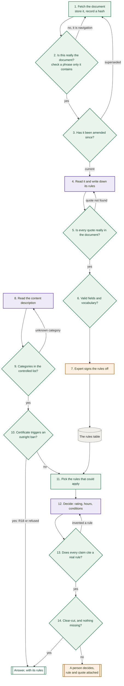
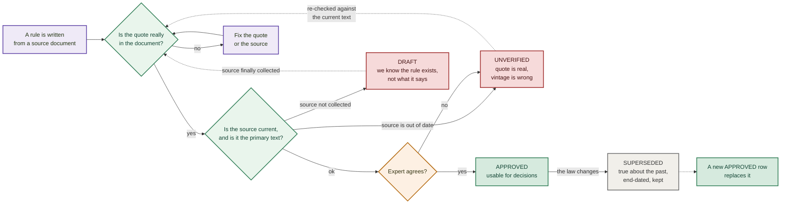
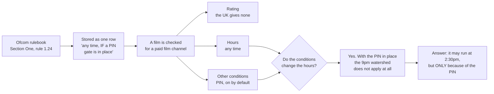

# How it works

How a content description becomes a decision, and where the rules come in.

## The flow

Three kinds of step, and the distinction matters more than it looks:

| | |
|---|---|
| 🟩 **Code** | Deterministic. Same input, same output, every time. Costs nothing, cannot be argued with. |
| 🟪 **Model** | Needs reading, weighing or judgement. Used only where code genuinely cannot do the job. |
| 🟧 **Person** | A judgement with consequences, or a decision nobody should automate. |



Steps 1 to 7 run **once per legal document**, and again when the law changes. Steps 8 to 14
run **once per showing**.

### What happens when a rule does not pass

Step 7 is not pass-or-bin. A rule that fails a check gets a **status**, and the status decides
whether a decision may use it. Only `approved` rules are ever handed to step 12.



**How a rule actually ends up in each state.** Every one of these has happened here.

| Status | How it happens | The real case |
|---|---|---|
| `draft` | You learn a rule exists from a source that **is not the rule**. You can write down that it binds, but not what it demands. | French channels each sign an individual agreement with the regulator. An enforcement decision cited those agreements, which proved they exist and bind, but the agreements themselves are not published centrally. |
| `unverified` | Either the source could not be read yet, or it was read and something is off. The quote can be real and the document real while the **vintage** is wrong. | Two rules cited guidance from 2015 that a 2018 statement had restructured. Correct quote, correct document, superseded edition. |
| `superseded` | The law changed. The old row is not wrong; it was correct until a date. | A 2014 amendment broadened a French category. The old wording stays, end-dated, because explaining a decision made in 2013 needs the rule as it stood in 2013. |
| `approved` | Quote verified against the stored document, fields valid, source current, expert agreed. | 103 of 103 rules. |

Two things follow from this that are easy to miss.

**A rule can be correct and still unusable.** `draft` is not a complaint about quality. It is the
table being honest that a whole layer of binding obligation exists which it cannot describe,
so a decision for a French channel should say "check the channel's own agreement" rather than
implying the general law is the whole answer.

**Deleting a superseded rule breaks the past.** The question a regulator asks is "why did you
clear that programme in 2013?", and answering it needs the rule as it was then, not as it is
now.

### Why only three steps use a model

The rule applied here is: **if a step can be done by comparing strings, it must not be done by
a model.** A model asked a question code can answer is slower, costs more, and can be talked
out of the right answer. Code cannot be talked out of anything.

So every model step had to justify itself:

| Step | Could code do it? | Why not |
|---|---|---|
| 4. Read a document, write down its rules | **No** | Turning prose law into structured rules needs reading comprehension. There is no pattern to match. |
| 8. Describe the content | **No** | "Two teenagers share a cigarette, played for laughs" has to become a category, a treatment and a timecode. Nothing mechanical does that. |
| 12. Decide | **Partly, and the part that can is not done here** | Applying a fixed time to a known category is a lookup. Weighing whether violence is "presented repeatedly" is not. Step 11 hands over only the rules that could apply, so the model is asked the narrow question and not the broad one. |

And every model step is **gated by cheaper checks first**:

- Step 4 never runs on a file that failed step 2. Extracting rules from a saved page of
  website navigation costs a model call and produces confident nonsense.
- Step 12 never runs when step 10 has already settled it. A BBFC R18 certificate is an
  outright ban: nothing in any context lifts it, so asking a model can only introduce a chance
  of it being argued away.
- Step 12 is not asked about rules step 11 already excluded.

### What each check catches

| Check | Catches | Already caught, for real |
|---|---|---|
| 2. Is this the document? | A saved page that is all menus and navigation | A French source saved as 12,493 characters of pure site navigation, which passed a length test |
| 3. Amended since? | A rule whose wording a later instrument replaced | Twice. Both times the old version was internally consistent and agreed with other sources of the same age |
| 5. Quote really present? | Paraphrase passed off as a quotation, wrong source cited | Four quotes, including one with a full stop added that cut off the words making the rule enforceable |
| 6. Valid vocabulary? | A value outside the list, which matches nothing and errors nowhere | Two spellings of one service type, which silently dropped a rule from every decision using the other |
| 9. Known category? | An observation that would match no rule | Enforced before the decision step rather than discovered after |
| 13. Claims cite real rules? | A decision citing a rule that does not exist | |
| 14. Clear-cut? | Automating a judgement call | 38 of 103 rules are judgement calls and route to a person |

Every defect in that right-hand column **looked completely fine**. None was found by rereading.
Each was found by something mechanical comparing the work against a source outside it.

## Which steps belong to which task

All fourteen steps are **Task 1**. Task 2 adds no steps: it asks what breaks when the same
flow runs for thirty countries instead of two.

| Steps | Task 1 | What Task 2 asks about them |
|---|---|---|
| 1, 2, 3, fetch and validate the document | Deliverable: *sources, with links and scope* | Source collection at scale: who finds them, how you know a document is current, what happens on amendment |
| 4, write down the rules | Deliverable: *the table of rules* | Rule representation. One schema for every country; which differences are data rather than code |
| 5, 6, quote and vocabulary checks | **Not asked for** | **Testing for correctness.** Task 2 asks this directly, and these are the answer |
| 7, expert sign-off | Not asked for | **Automate versus local expert.** The one step that cannot scale by engineering |
| 8, describe the content | Deliverable: *the prompt* | Shared. Same everywhere |
| 9, 10, vocabulary and prohibition gates | Not asked for | Shared logic, country data |
| 11, pick the rules | Deliverable: *the prompt* | Where "what looks shared and is not" bites |
| 12, decide | Deliverable: *the prompt*, plus *reasoning with rule references* | Shared. The three passes do not change per country |
| 13, 14, citation and clear-cut checks | Deliverable: *missing information or need for human review* | **Measurement.** The escalation rate is the metric that says whether this is working |

Two things worth drawing out.

**The checks were not asked for by Task 1.** Nothing in the brief requires quotes to be
verified. They exist because Task 2 asks how you know the rules are right, and that needs a
mechanical answer rather than an assurance. They then earned their place in Task 1 by catching
four defective quotes, two rules citing the wrong document, a reversed rule and two silently
dropped vocabularies.

**Steps 1 to 7 run per document; 8 to 14 run per showing.** That split is the architecture.
Merge them and nothing separates "what the rule says" from "what I decided", so a misreading
cannot be caught and the quote check has nothing to check against.

## One rule, followed all the way through

A real example. The same film, on two different channels.



The thing to notice is the question in the middle. The hours and the PIN are worked out
**separately** and then checked against each other, because the PIN changes the hours.

Say only "any time" and you have dropped the condition that earned it, and a channel without
a PIN would act on it. Say only "not before 9pm" and you have missed that a PIN would lift
that, which costs the channel a slot it was entitled to. Both are wrong, in opposite
directions.

Put the same film on an ordinary free-to-air channel with no PIN and the answer is 9pm. Same
film, same certificate, nothing re-edited.

## The steps in more detail

### Steps 1 to 7: turning documents into a table

Prompt: `prompts/BUILD_rules_from_sources.md`

This takes **one legal document** and produces **rows**. Its
job is reading law. It runs 20 times, once per source, and again whenever a regulator amends
something.

Each row carries a `verbatim_quote` that appears character for character in the stored file.
**All 103 approved rules do**, and a rule without one fails the build.
`pipeline/verify_rules.py --with-quotes` checks every one mechanically. A row that fails
does not ship.

### Step 8: describing the content

Prompt: `prompts/RUN_1_describe_content.md`

This takes a **content description** and produces **timecoded
observations**. Its job is reading content.

It **does not know the rules exist**, and that is the point. An extractor that knows the
thresholds shades its descriptions toward the rating it expects. Write "graphic violence"
instead of "a man is struck with a bottle, blood is visible" and the decision has already been
made, invisibly, by an adjective.

It also records what it was **not** told. `not_stated` is a deliverable, not an apology.

### Steps 9 to 11: gates, then picking the rules

Code, not a prompt: `pipeline/precheck.py` then `pipeline/run_decision.py`

`precheck.py` stops the run rather than warning about it, and says which of the two gates
stopped it:

| exit | meaning |
|---|---|
| `0` | both gates clear, continue to the decision prompt |
| `1` | a certificate triggers an absolute prohibition. The answer is already known, so no model is asked |
| `2` | the extraction is unusable: a category outside the controlled list, or output that is not valid JSON. Fix and re-run |

Exit `2` matters more than it looks. An out-of-vocabulary category does not cause an error. It
causes the observation to match no rule, so the answer comes back looking complete with that
observation silently absent, which is the failure mode this whole pipeline is built against.

Then `run_decision.py` picks the rules that could apply: matching country, matching service
type, matching content category, plus a set that is **always** included.

That last part exists because of a real bug. Access-control rules describe how a programme is
*delivered*, not what is in it, so no content description ever mentions them, so a
category-based filter dropped them every single time. The rule defining what a PIN gate must
be never reached the decision engine, while the rule granting an any-hour permission
*conditional on that gate* did.

### Steps 12 to 14: deciding

Prompt: `prompts/RUN_2_decide.md`

This applies only the rules it was handed. It never recalls regulation,
and it cites a `rule_id` for every claim.

It runs three passes that are deliberately independent: classification, hours, other
restrictions. Then it compares them, because in these two countries they come apart in both
directions.

## Why the rules live in a table rather than in the prompt

Three reasons, all learned the hard way.

**Auditability.** Every decision cites a `rule_id` resolving to a row with a clause reference
and a quote checked against the source. A reviewer can verify any claim without reading the
prompt or trusting its author. The verifier reports how many rows carry a quote, not only how
many passed, because a count of the rows that opted in will always report success.

**Reliability.** Feeding whole legal codes into a decision means re-deriving the law on every
request, slightly differently each time. Here a rule is read once, checked once, signed off
once.

**Maintainability.** When a regulator amends something, you edit a row and version the old
one. You do not re-read everything. This matters more than it sounds: two of the worst errors
in this project were rules carrying wording that an amendment had replaced, and both survived
review because the superseded version was internally coherent and corroborated by other
sources of the same vintage.

## Reading a rule row

```
rule_id             UK-SCH-007
authority_rank      1                 lower wins when rules conflict
service_type        all_linear_tv     controlled vocabulary, enforced in CI
content_category    scheduling_general
classification      exempt
time_rule_machine   any_time;override=watershed_disapplied_when_mdp_in_place
determinacy         bright_line       how to score it
ambiguity_flag      clear             how confident the extraction is
verbatim_quote      "does not apply to channels when mandatory daytime protection"
source_doc          UK-S1
clause_ref          Rule 1.4 (meaning of the watershed)
```

Two fields are easy to confuse and must not be merged. **`determinacy`** describes the rule:
is the line bright, conditional, or a judgment? **`ambiguity_flag`** describes the extraction:
are we sure we read it right? A crisp rule nobody is sure was transcribed correctly is
`bright_line` + `unverified`, and merging the two loses exactly that state.

## Running it

```bash
pip install openpyxl pypdf

python pipeline/verify_rules.py --with-quotes        # does the table hold up?
python pipeline/run_decision.py --countries UK FR \
    --service free_to_air --categories violence      # assemble a decision context
python pipeline/precheck.py run1_output.json          # deterministic gates, before any model
python pipeline/build_timeline.py                    # regenerate docs/timeline.html
```

`docs/timeline.html` shows, for a chosen country and service, which rules bite at which hour
across a 24-hour day. It is built from the table, so a rule appears only if its token encodes
a real clock time. Rules whose restriction is not a time are listed separately rather than
drawn at an invented hour.
