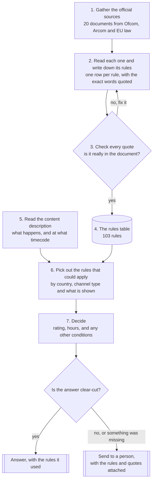
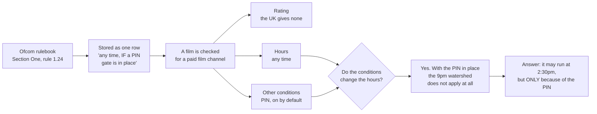

# How it works

How a content description becomes a decision, and where the rules come in.

## The seven steps

Steps 1 to 4 happen **once per legal document**, and again whenever a regulator changes the
law. Steps 5 to 7 happen **once per showing**.



### What "clear-cut" means in step 8

Some rules are a fixed line. *Category V may only air between midnight and 5am.* There is
nothing to weigh: you either know the category or you do not, and the answer follows.

Other rules ask for a judgement. *Is this violence "presented repeatedly"?* *Is this treatment
"derogatory"?* Two experienced people can read the same scene and disagree, and the regulator
expects a human to weigh it.

The table records which kind each rule is, so step 8 is a lookup rather than a guess. **45 of
the 103 rules are fixed lines. 38 are judgement calls.** A decision goes to a person when it
rests on a judgement rule, or when the description left out something the rule needed, such as
which channel it is going out on.

The point is not to answer everything automatically. It is to answer the clear-cut majority
and hand a person the hard ones with the rule and its exact wording already attached, so they
start from the evidence instead of a blank page.

## Which steps belong to which task

All seven steps are **Task 1**. Task 2 does not add steps: it asks what breaks when the same
seven are run for thirty countries instead of two.

| Step | Task 1 | What Task 2 asks about it |
|---|---|---|
| 1. Gather the sources | Deliverable: *sources, with links and scope* | Source collection and validation at scale. Who finds them, how you know a document is current, what happens when a regulator amends one |
| 2. Write down the rules | Deliverable: *the table of rules* | Rule representation. One schema for every country, and which differences are data rather than code |
| 3. Check every quote | Not asked for | **Testing for correctness.** Task 2 asks this directly, and this is the answer built in Task 1 |
| 4. The rules table | Deliverable: *the table of rules* | Shared versus country-specific. The schema is shared; only the values differ |
| 5. Read the content | Deliverable: *the prompt* | Shared. The extraction step is the same everywhere |
| 6. Pick the rules that apply | Deliverable: *the prompt* | Shared logic, country data. This is where "what looks shared and is not" bites |
| 7. Decide | Deliverable: *the prompt*, plus *reasoning with rule references* | Shared. The three passes do not change per country |
| 8. Clear-cut, or a person? | Deliverable: *missing information or need for human review* | **Measurement, and automate versus local expert.** The escalation rate is the metric that tells you whether either is working |

Two things worth drawing out.

**Step 3 was not asked for by Task 1.** Nothing in the brief requires the quotes to be
checked. It exists because Task 2 asks how you know the rules are right, and the honest answer
has to be something mechanical rather than care. It then earned its place in Task 1 by
catching four defective quotes and a rule citing the wrong document, none of which was
findable by rereading.

**Steps 1 to 4 run once per document; steps 5 to 8 run per showing.** That split is the whole
architecture. Merge them and there is nothing separating "what the rule says" from "what I
decided", so a misreading cannot be caught, and there is nothing for step 3 to check.

## One rule, followed all the way through

A real example. The same film, on two different channels.



The thing to notice is the question in the middle. The hours and the PIN are worked out
**separately** and then checked against each other, because the PIN changes the hours.

Say only "any time" and you have dropped the condition that earned it, and a channel without
a PIN would act on it. Say only "not before 9pm" and you have missed that a PIN would lift
that, which costs the channel a slot it was entitled to. Both are wrong, in opposite
directions.

Put the same film on an ordinary free-to-air channel with no PIN and the answer is 9pm. Same
film, same certificate, nothing re-edited.

## The steps in more detail

### Steps 1 to 4: turning documents into a table

Prompt: `prompts/BUILD_rules_from_sources.md`

This takes **one legal document** and produces **rows**. Its
job is reading law. It runs 20 times, once per source, and again whenever a regulator amends
something.

Each row carries a `verbatim_quote` that appears character for character in the stored file.
**All 102 approved rules do**, and a rule without one fails the build.
`pipeline/verify_rules.py --with-quotes` checks every one mechanically. A row that fails
does not ship.

### Step 5: describing the content

Prompt: `prompts/RUN_1_describe_content.md`

This takes a **content description** and produces **timecoded
observations**. Its job is reading content.

It **does not know the rules exist**, and that is the point. An extractor that knows the
thresholds shades its descriptions toward the rating it expects. Write "graphic violence"
instead of "a man is struck with a bottle, blood is visible" and the decision has already been
made, invisibly, by an adjective.

It also records what it was **not** told. `not_stated` is a deliverable, not an apology.

### Step 6: picking the rules that could apply

Code, not a prompt: `pipeline/run_decision.py`

It picks the rules that could apply: matching country, matching service
type, matching content category, plus a set that is **always** included.

That last part exists because of a real bug. Access-control rules describe how a programme is
*delivered*, not what is in it, so no content description ever mentions them, so a
category-based filter dropped them every single time. The rule defining what a PIN gate must
be never reached the decision engine, while the rule granting an any-hour permission
*conditional on that gate* did.

### Steps 7 and 8: deciding

Prompt: `prompts/RUN_2_decide.md`

This applies only the rules it was handed. It never recalls regulation,
and it cites a `rule_id` for every claim.

It runs three passes that are deliberately independent: classification, hours, other
restrictions. Then it compares them, because in these two countries they come apart in both
directions.

## Why the rules live in a table rather than in the prompt

Three reasons, all learned the hard way.

**Auditability.** Every decision cites a `rule_id` resolving to a row with a clause reference
and a quote checked against the source. A reviewer can verify any claim without reading the
prompt or trusting its author. The verifier reports how many rows carry a quote, not only how
many passed, because a count of the rows that opted in will always report success.

**Reliability.** Feeding whole legal codes into a decision means re-deriving the law on every
request, slightly differently each time. Here a rule is read once, checked once, signed off
once.

**Maintainability.** When a regulator amends something, you edit a row and version the old
one. You do not re-read everything. This matters more than it sounds: two of the worst errors
in this project were rules carrying wording that an amendment had replaced, and both survived
review because the superseded version was internally coherent and corroborated by other
sources of the same vintage.

## Reading a rule row

```
rule_id             UK-SCH-007
authority_rank      1                 lower wins when rules conflict
service_type        all_linear_tv     controlled vocabulary, enforced in CI
content_category    scheduling_general
classification      exempt
time_rule_machine   any_time;override=watershed_disapplied_when_mdp_in_place
determinacy         bright_line       how to score it
ambiguity_flag      clear             how confident the extraction is
verbatim_quote      "does not apply to channels when mandatory daytime protection"
source_doc          UK-S1
clause_ref          Rule 1.4 (meaning of the watershed)
```

Two fields are easy to confuse and must not be merged. **`determinacy`** describes the rule:
is the line bright, conditional, or a judgment? **`ambiguity_flag`** describes the extraction:
are we sure we read it right? A crisp rule nobody is sure was transcribed correctly is
`bright_line` + `unverified`, and merging the two loses exactly that state.

## Running it

```bash
pip install openpyxl pypdf

python pipeline/verify_rules.py --with-quotes        # does the table hold up?
python pipeline/run_decision.py --countries UK FR \
    --service free_to_air --categories violence      # assemble a decision context
python pipeline/build_timeline.py                    # regenerate docs/timeline.html
```

`docs/timeline.html` shows, for a chosen country and service, which rules bite at which hour
across a 24-hour day. It is built from the table, so a rule appears only if its token encodes
a real clock time. Rules whose restriction is not a time are listed separately rather than
drawn at an invented hour.
