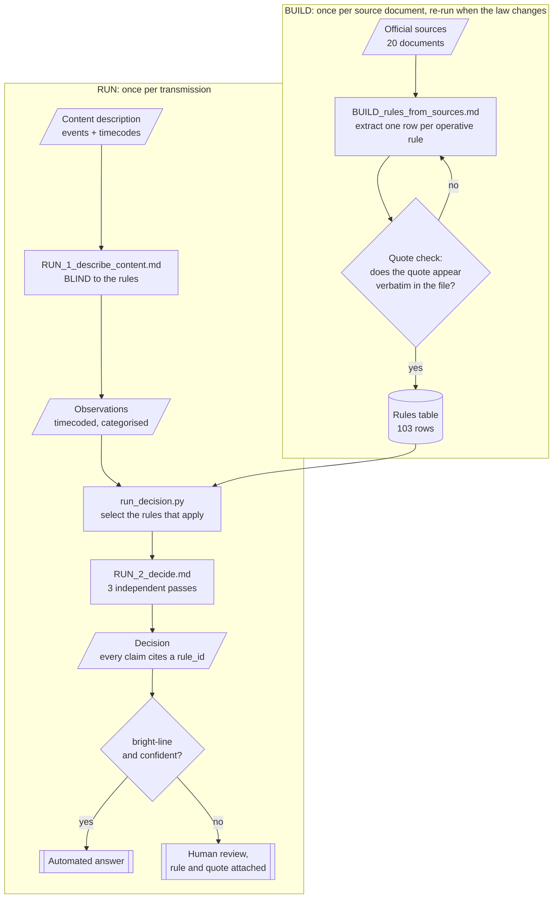
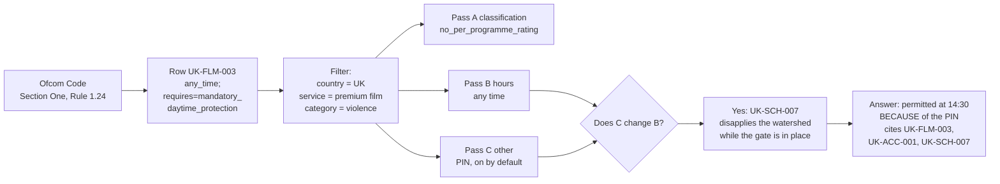

# How it works

How a content description becomes a decision, and where the rules come in.

## The shape of it



Two loops at different speeds. The top runs once per document and again when the law changes.
The bottom runs per transmission.

**They must stay separate.** A system that reads regulation and applies it in one step has
nothing dividing "what the rule says" from "what I decided", so a misreading cannot be caught.
Splitting them is what makes the quote check possible, and that check found four defective
quotes the moment real sources arrived.

## How a rule reaches a decision

A worked trace, following one real rule from the statute to the answer.



The thing to notice is step G. The hours and the access control are computed **separately**
and then checked against each other, because the access control can change or remove the
hours answer. Report "any time" without the PIN condition and the answer is wrong; report a
bar before 21:00 without noticing the measure is available and it is wrong the other way.

## What each stage actually does

### BUILD, run once per source document

`prompts/BUILD_rules_from_sources.md` takes **one legal document** and produces **rows**. Its
job is reading law. It runs 20 times, once per source, and again whenever a regulator amends
something.

Each row should carry a `verbatim_quote` that appears character for character in the stored
file. **56 of the 102 approved rules do; 46 do not and are therefore never checked** (C-15).
Treat an unquoted row as unverified whatever its status says. `pipeline/verify_rules.py --with-quotes` checks every one mechanically. A row that fails
does not ship.

### RUN 1, run once per asset

`prompts/RUN_1_describe_content.md` takes a **content description** and produces **timecoded
observations**. Its job is reading content.

It **does not know the rules exist**, and that is the point. An extractor that knows the
thresholds shades its descriptions toward the rating it expects. Write "graphic violence"
instead of "a man is struck with a bottle, blood is visible" and the decision has already been
made, invisibly, by an adjective.

It also records what it was **not** told. `not_stated` is a deliverable, not an apology.

### Selection, in code not in the prompt

`pipeline/run_decision.py` picks the rules that could apply: matching country, matching service
type, matching content category, plus a set that is **always** included.

That last part exists because of a real bug. Access-control rules describe how a programme is
*delivered*, not what is in it, so no content description ever mentions them, so a
category-based filter dropped them every single time. The rule defining what a PIN gate must
be never reached the decision engine, while the rule granting an any-hour permission
*conditional on that gate* did.

### RUN 2, the decision

`prompts/RUN_2_decide.md` applies only the rules it was handed. It never recalls regulation,
and it cites a `rule_id` for every claim.

It runs three passes that are deliberately independent: classification, hours, other
restrictions. Then it compares them, because in these two countries they come apart in both
directions.

## Why the rules live in a table rather than in the prompt

Three reasons, all learned the hard way.

**Auditability.** Every decision cites a `rule_id` resolving to a row with a clause reference
and, where one is present, a quote checked against the source. A reviewer can verify such a
claim without reading the prompt or trusting its author. Where no quote is present that
guarantee does not hold, which is why the verifier now reports how many rows have one rather
than only how many passed.

**Reliability.** Feeding whole legal codes into a decision means re-deriving the law on every
request, slightly differently each time. Here a rule is read once, checked once, signed off
once.

**Maintainability.** When a regulator amends something, you edit a row and version the old
one. You do not re-read everything. This matters more than it sounds: two of the worst errors
in this project were rules carrying wording that an amendment had replaced, and both survived
review because the superseded version was internally coherent and corroborated by other
sources of the same vintage.

## Reading a rule row

```
rule_id             UK-SCH-007
authority_rank      1                 lower wins when rules conflict
service_type        all_linear_tv     controlled vocabulary, enforced in CI
content_category    scheduling_general
classification      exempt
time_rule_machine   any_time;override=watershed_disapplied_when_mdp_in_place
determinacy         bright_line       how to score it
ambiguity_flag      clear             how confident the extraction is
verbatim_quote      "does not apply to channels when mandatory daytime protection"
source_doc          UK-S1
clause_ref          Rule 1.4 (meaning of the watershed)
```

Two fields are easy to confuse and must not be merged. **`determinacy`** describes the rule:
is the line bright, conditional, or a judgment? **`ambiguity_flag`** describes the extraction:
are we sure we read it right? A crisp rule nobody is sure was transcribed correctly is
`bright_line` + `unverified`, and merging the two loses exactly that state.

## Running it

```bash
pip install openpyxl pypdf

python pipeline/verify_rules.py --with-quotes        # does the table hold up?
python pipeline/run_decision.py --countries UK FR \
    --service free_to_air --categories violence      # assemble a decision context
python pipeline/build_timeline.py                    # regenerate docs/timeline.html
```

`docs/timeline.html` shows, for a chosen country and service, which rules bite at which hour
across a 24-hour day. It is built from the table, so a rule appears only if its token encodes
a real clock time. Rules whose restriction is not a time are listed separately rather than
drawn at an invented hour.
