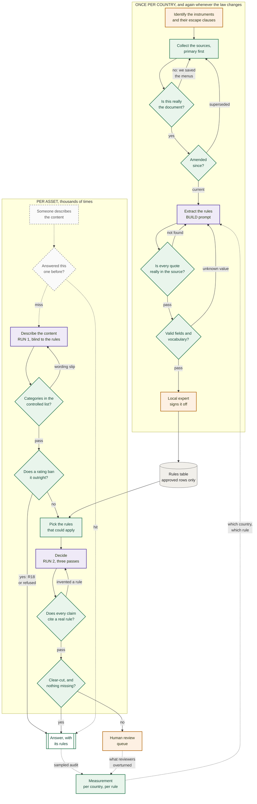

# Task 2, Scaling to dozens of countries

## What is answered where

The five questions, and the four things Task 2 asks for:

| Question | Section |
|---|---|
| 1. Source collection and validation | [1. Source collection and validation](#1-source-collection-and-validation) |
| 2. Organizing the rules | [2. Organizing the rules](#2-organizing-the-rules), and [2b, decided cases](#2b-learning-from-decisions-the-regulator-already-made) |
| 3. Solution structure | [3. Solution structure](#3-solution-structure) |
| 4. Correctness testing | [4. Correctness testing](#4-correctness-testing) |
| 5. Measurement and diagnosis | [5. Measurement and diagnosis](#5-measurement-and-diagnosis) |

| Deliverable | Section |
|---|---|
| A process diagram | [Process](#process) |
| An example of how a single rule is represented | [Deliverable: how a single rule is represented](#deliverable-how-a-single-rule-is-represented) |
| A validation plan | [4. Correctness testing](#4-correctness-testing) |
| Success metrics | [5. Measurement and diagnosis](#5-measurement-and-diagnosis) |
| **What can be automated and where a local expert is required** | [what can be automated](#what-can-be-automated-and-what-needs-a-local-expert) |

One section is not asked for and is here because the order countries are added in turns out
to matter: [rollout order](#rollout-order). The
[answer table](#deliverable-what-comes-out-at-the-end) is likewise extra; it is what the
design produces at the end.

**On length.** The brief asks for a *concise* proposal and this is not concise. An external
reviewer put it at roughly four times the length it needs, and that is a fair reading. Every
required item above is answered and findable from this table; the excess is in the discussion
around them rather than in the answers themselves.

---

## The claim this plan rests on

Two countries produced about twenty real defects. **Every single one was silent.** Nothing
crashed, nothing looked wrong, and not one was found by re-reading the work:

- four quotes that were paraphrases, or had punctuation I had added that cut a sentence
  before the words making the rule enforceable
- a rule carrying wording superseded by an amendment in 2014, which would have under-rated
  content
- the same mistake again, in rules written hours after I wrote down the lesson
- a whole Code section wrongly scoped out, because I tested for one phrase
- a rule that could never reach the decision engine, because it described delivery rather
  than content
- two spellings of one service name, dropping a rule from every slice that used the other
- a manifest column deleted by a script that had never heard of it
- files sitting on disk reported as missing, because a lockfile was treated as proof
- three source URLs that were dead in three different ways, all labelled "bot-blocked"

Every one was caught by a mechanical check comparing the work against something external.

So the thing to scale is **not** the rules. Rules are the easy part, they are typing. What
has to scale is the machinery that catches silent error, because at thirty countries nobody
will read the table, and an error that produces complete-looking output is indistinguishable
from correctness until a regulator says otherwise.

**Design principle: assume every country's extraction is wrong somewhere, and build the thing
that finds it.**

---

## Problems that are new, not just bigger

A lot of scaling up is simply doing the same thing more times and watching for what breaks.
That part matters, and it is most of this document.

The problems below are different. They are not bigger versions of something we faced with two
countries, which means no amount of care in Task 1 would have found them. Most have to be
built in before the third country is added, because adding them later means going back and
redoing every country already running.

The first one is listed out of scope. It is a genuine prerequisite that the brief does not
ask about, and it is here so that its absence from the plan is a decision rather than an
oversight.

### 1. Knowing whose rules apply in the first place, which is a version 2 problem

**Out of scope, and flagged here so it is not mistaken for an oversight.** Task 2 asks how to
collect, organize, test and measure rules for dozens of countries. It does not ask how to work
out which country's rules govern a particular channel. That is a real question and it sits
upstream of everything here, but it is a different project.

It is worth half a page because the system quietly assumes an answer to it.

**The assumption.** The system takes a country as an input and applies that country's rules.
That is only correct if the country you hand it is the country whose regulator actually covers
the channel. Those are not always the same thing. A channel can be run from one country and
watched in several others, and countries differ on who gets to regulate it. Some say the
rules of the country where the **company** is based apply, and receiving countries must accept
that. Others say any channel watched on their territory needs their licence and follows their
rules.

**It is already live in Task 1, which I missed.** The two countries here do it in opposite
ways. France, in the EU, goes by where the company is based. The UK, since leaving the EU,
mainly goes by whether the service is available in the UK. So the question was present with
two countries and I wrote earlier that it only appears with thirty. That was wrong.

**No rule in the table is affected.** Every row is about content and timing, not about who
regulates whom. What is missing is a precondition the table never states, now written down in
`out_of_scope/SCOPE.md` and tracked as open conflict C-16.

**The sketch, for version 2.** Two tables, and the second is the one people get wrong:

- **Per channel:** which regulator covers it, on what basis, confirmed by whom and when.
- **Per pair of countries:** whether country B accepts country A's regulator. This belongs to
  the *relationship between two countries*, not to the channel, so it is one fixed grid shared
  by every channel rather than work that repeats per channel.

Then the lookup is: find the channel's regulator, check whether the receiving country accepts
it, and apply **exactly one** country's rules. If either table has no confirmed answer, refuse
to decide rather than guess.

**One warning worth carrying into version 2.** When two countries' rules differ, the instinct
is to apply the stricter one. That is usually wrong, because usually only one country's rules
were ever going to apply. Taking the stricter one pushes content later than the law requires,
which is the over-rating failure in section 5, and nobody ever complains about that one.

**On research for it.** In Europe there is a free public database, MAVISE, run by the European
Audiovisual Observatory, which lists which country regulates each channel for 42 European
countries plus Morocco, updated monthly from the regulators' own records. It is close to the
per-channel table above. There is no worldwide equivalent and no international body that
settles disagreements, so outside Europe this is lawyer work from the start. That difference
is the real cost of the feature, which is part of why it is version 2 and not version 1.

### 2. Getting a description out of a two-hour film

The system starts from a written description of what happens, with timecodes. Something has to
produce that. With a handful of titles a person watches and takes notes. At scale that is the
most expensive part of the whole operation, so the question is what a model can take over.

**It cannot be done in one pass.** You cannot hand a model a two-hour film and ask for a
timecoded list of everything that matters. The things that matter are often two seconds long,
and anything reading the film as a whole will summarise the plot rather than catalogue the
moments.

**Cutting it into pieces is the easy part, and it is not a model's job.** Finding where the
shots change in a video is a solved problem that ordinary software has done for years by
comparing consecutive frames. It needs no model, it is cheap, and it is repeatable, which by
this project's own rule means a model should not be doing it.

What you get out is camera cuts, not story scenes. For our purpose that is fine. We are not
trying to find where a scene begins dramatically, only to get pieces small enough that
nothing hides inside one.

**Then two passes over the pieces, and the second is the one people forget.**

*Pass one, per piece:* give the model the frames from that piece plus the words spoken in it,
and ask what happens. This is the part a vision model can genuinely do. It needs the audio as
well as the pictures, because a whole category of rules is about **language**, and no number
of frames will catch a word.

*Pass two, over all the pieces at once:* this one takes the output of pass one, not the video.
It exists because several of the most important judgements **cannot be made from one piece**:

- Rules ask whether something is *sustained*, *repeated*, or *dwelt on*. One cut cannot tell
  you. Counting across the whole film can.
- Rules ask whether violence is *glamorised* or *presented as a solution*. That is about how
  the film treats the act afterwards, which is in a different piece.
- **Context lives somewhere else in the film.** Whether something is comedic, fictional or
  historical is usually established long before or after the moment in question. A model
  looking at thirty seconds in isolation cannot see it, and will tend to describe a comedy
  as though it were real.

That second pass maps onto something the extraction prompt already has: the whole-asset flags
and the running totals, as opposed to the per-moment observations.

**What this is likely to get wrong, which decides where the money goes.**

The dangerous failure is a **missed moment**, not a misjudged one. If the model never mentions
the stabbing, no rule about stabbing fires, and the answer comes back clean with full
citations. Nothing downstream can catch it, because nothing downstream has seen the video.
Sampling too few frames is how this happens, and a brief shot is exactly the kind of thing a
regulator cares about.

So the sampling rate is a compliance decision, not a performance tuning knob, and it should be
set by testing against content with known findings rather than by what looks reasonable.

**A rough sense of cost.** A two-hour film cut at every camera change produces well over a
thousand pieces. Sampling frames from each and transcribing the audio is real money per title,
paid again on every re-run. That is the strongest argument for storing answers and
reusing them, described under the amendment problem in section 1 and sketched as steps 0b to
0d in `out_of_scope/HOW_IT_WORKS.md`. The expensive part is describing the film, and the description
does not change when the law does, so an amendment should invalidate the decision and
keep the description.

**What stays with a person.** Deciding the sampling rate. Reviewing anything the model marked
uncertain. And spot-checking cleared titles against the video, because a missed moment is
invisible from the paperwork and the paperwork is all anyone else ever sees.

### 3. Finding enough experts is what actually limits you

Reading a law and writing down its rules is the cheap part, and it keeps getting cheaper.
Having someone qualified confirm that you read it correctly does not get cheaper.

Every country needs a person who knows that country's broadcasting rules well enough to say
"yes, that is what this means here". Thirty countries means thirty such people, each of whom
also has to agree to a turnaround time when a law changes, because a law can change at any
time and a rule nobody has re-checked is a guess.

Finding and keeping those thirty people is a hiring problem, not a software problem, and it is
the thing that really caps how many countries you can cover. However fast the software gets,
a country cannot go live until someone has signed off its rules. So plan it as a staffing
list with real names against each country, and treat an empty seat as a reason not to launch
there rather than as a task for later.

### 4. Legal changes go from being events to being a constant stream

With two countries, a law changing is an event. It happens, you notice, you deal with it.

With thirty countries, each relying on several documents, something somewhere is always
changing. It stops being an event and becomes a steady stream of work, and a steady stream
needs sorting, because some changes matter immediately and some can wait.

The useful way to sort them is by what the change touches. If it changes a clear-cut rule that
decisions are actually using, it is urgent, and the system should stop giving automatic
answers that depend on that rule until it is updated. If it changes a rule that no decision
has used in six months, it can wait for the next scheduled review. The system already records
which rules each decision used, so a computer can do this sorting. Nobody has to judge it.

### 5. You stop being able to read your own sources

With two countries I could read both. The one place where I had to rely on a translation is
flagged in the table as a known weakness.

With thirty, most of the laws will be in languages nobody on the team reads. Some will be in
alphabets that are not the Latin one, some will read right to left, and some will be scanned
documents where the computer's copy of the text is wrong even though the page looks fine.

The good news is that the quote checker still works. It compares the quote we wrote down
against the stored document letter by letter, and that comparison does not care what language
either is in.

The bad news is that this guarantee is smaller than it sounds. It proves the quote was copied
correctly. It cannot prove we picked the right sentence, or that two lines later the law says
"except when...", or that a word with a special legal meaning means what a dictionary says it
means. **The automatic checks survive the language barrier. Human judgement does not.** That
is exactly why point 2 above, finding experts, is the real limit.

### 6. One country going wrong must not take down the rest

With two countries, if the table is wrong you stop and fix it.

With thirty, a problem in one country must not break the other twenty-nine. Just as important,
it must not be *hidden* by the other twenty-nine. If you only look at the overall score, 96%
correct could be twenty-nine countries at 99% and one country at 20%. The overall number looks
healthy while one market is being answered close to randomly.

Two things follow. First, every measurement is reported per country and never only as a
combined figure. Second, each country needs its own automatic stop: if its test results drop
below an agreed level, that country stops giving automatic answers and sends everything to a
person, while the other countries carry on as normal. This has to be designed in early,
because it changes how results are stored.

### 7. Changing the shape of the table stops being easy

The rules table has a fixed set of columns. Adding a new column, or changing what one means,
is an afternoon's work when there are two countries in it.

With thirty countries it is a much bigger job. Every country's rows have to be updated, and
for each country the expert may need to look again at the rows that changed, because a column
that means something slightly different is a row that has not really been checked.

So the table's shape needs a version number, and every row needs to record which version it
was written under. That way a change can be rolled out one country at a time instead of
having to happen everywhere at once.

This is the real reason for the rollout advice further down. If the shape of the table is
still changing by the tenth country, every country added after that inherits the problem and
every country added before it has to be revisited.

---

## And then the part that is just more of the same

The rest of this document is the Task 1 flow run thirty times. The fourteen steps in
`out_of_scope/HOW_IT_WORKS.md` do not change; what changes is which of them breaks first and what has to be
true before country three rather than after country thirty.

| This document asks about | Which steps |
|---|---|
| Source collection and validation | 1, 2, 3 |
| Rule representation | 4 |
| Testing for correctness | 5, 6, 13 |
| Automate versus local expert | 7, and the model-versus-code audit throughout |
| Shared versus country-specific | 11 |
| Measurement and diagnosis | 14 |

## Process

The process at thirty countries, end to end. Colours say **who or what does each step**, which
matters more than the order: every purple box costs money per asset and can be argued with,
every green box is free and cannot.

| | |
|---|---|
| 🟩 Code | Deterministic. Same input, same output. Costs nothing, cannot be argued with |
| 🟪 Model | Needs reading or weighing. Used only where code genuinely cannot do the job |
| 🟧 Person | A judgement with consequences |
| ⬜ Dashed | Not built in this project |



**Two loops at very different speeds.** The top runs once per country and again whenever the
law changes. The bottom runs per asset, thousands of times. **They must not be merged.** A
system that reads regulation and applies it in one step has nothing separating *what the rule
says* from *what I decided*, so a misreading cannot be falsified: there is no stored claim to
check against the source.

**Every model step is gated by cheaper checks.** The two purple boxes are the only places that
cost money per run and the only places that can be reasoned out of a right answer. So nothing
reaches them that code could have settled: a rule is never extracted from a file that failed
the identity check, and a decision is never requested when the certificate already prohibits
the broadcast outright.

**The measurement loop closes back onto extraction, not onto the model.** Because every
decision carries `rule_id`s, an overturn points at a rule in a country rather than at "the
model", which is the difference between a fix and a complaint.

---

## 1. Source collection and validation

### Primary sources only, with everything else labelled

Rank each source 1-7: statute, regulator binding instrument, regulator guidance, enforcement
precedent, regulator summary, classification body, secondary. Conflicts resolve by lowest
number. **A rule whose only proof quote comes from rank 5 or below is an inference, and the
row must say so.** One row in the current table is exactly this and is flagged accordingly.

### The amendment problem, which is the one that will bite at scale

Two of the worst defects in Task 1 were the same error: a rule whose text had been amended,
where the table carried the old wording. The second occurred *hours after* I documented the
first.

It is hard to catch because the old version is **internally coherent and corroborated**. The
English translation and the pre-amendment French agreed with each other, both were simply
out of date. **Cross-checking sources does not catch this.** Only reading the amending
instrument does.

At thirty countries this is the single highest-volume failure. Requirements:

- every source row carries `amended_by` and `amendments_checked_on`
- **no rule may be `approved` while citing guidance older than the most recent amendment to
  the rule it interprets**, enforced in CI, not by discipline
- subscribe to each regulator's publication feed; an amendment moves every rule citing it to
  `needs_recheck` automatically
- consolidated text only. Original-publication URLs belong on superseded rows

An amendment also has to reach anything that **stored** an answer. If decisions are cached to
keep the cost per title down, every stored answer must record the `rule_id`s it relied on, so
an amendment drops exactly the answers that cite a rule from the amended document and leaves
the rest alone. A blanket flush on any amendment anywhere means that at thirty countries the
cache is cold almost all the time and was never worth building. The cache design, including
why the key cannot be the content alone and why a similarity threshold has to be validated on
adversarial pairs rather than random ones, is in `out_of_scope/HOW_IT_WORKS.md` under steps 0b to 0d.

**And an amendment is free information about itself.** When an amendment drops a set of stored
answers, keep a sample and re-decide those from scratch under the new rules, then compare them
with what was being served.

Identical means the amendment did not touch anything that mattered in practice, which is worth
knowing and is otherwise very hard to find out. Different means the cache was serving stale
law, and the comparison tells you **exactly which answers were wrong, in which direction, and
since when**, which is the first thing anyone will ask and normally the thing nobody can
answer. The sample costs a handful of decisions per amendment, and it is the only mechanism
here that measures the real-world impact of a legal change rather than just reacting to it.

It doubles as a regression test nobody has to write. The comparison is between two runs of the
same system over the same input with only the rules changed, so any difference is attributable
to the amendment or to non-determinism, and both are things you want to see.

### Contradictions, translation, and gaps

The brief asks about three things that all have the same shape: the source does not give you
a clean answer. Each needs a different response, and none of them is "pick the likeliest".

**Contradictions between sources.** Two documents say different things. Resolve by rank: the
lower the number in the list above, the more it counts, so a binding instrument beats a
guidance note and both beat a summary page. This is not theoretical. The French regulator's
own public summary page contradicted its binding text about which hours applied, and the
binding text won. **Record the losing reading too**, in the row's note. If someone later asks
why the summary page says otherwise, the answer is already written down.

**Translation.** Only the original language is legally authentic. Where we work from a
translation, the row says so, and a reviewer who reads the original has to re-check it. The
quote we store is the original-language quote, not the translated one, because that is the
text the law actually consists of. The translation goes alongside it for readers. This is a
live weakness here: the French rules are quoted from an official English translation that
states only the French is authentic.

**Missing information, meaning the source does not settle the question.** This is the one
people get wrong. There are three different situations and they are not interchangeable:

| situation | what it means | what to do |
|---|---|---|
| The document does not mention it | The law is genuinely silent | Do not write a rule. Silence is not permission and it is not prohibition. Log it as a question for the local expert |
| The document mentions it but is vague | The law leaves it to judgement | Write the rule, mark it as needing judgement, and route it to a person every time |
| We could not read it properly | Our problem, not the law's | Mark the row unverified and do not let it reach a decision until someone has read it |

Writing a confident rule for any of the three is worse than writing none, because a rule in
the table gets used. The worst habit to allow is filling a gap with what the neighbouring
country does.

### Link health, honestly

Three URLs failed in three different ways and I had labelled all three "bot-blocked". From
inside an automated environment a dead hostname, a retired path and a rejected query all look
identical, a failed fetch. Record the **observed** failure, and where no cause was observed
say "cause not established" rather than guessing the host's usual excuse.

Store a hash and the retrieval date for every document. Re-fetch quarterly; a changed hash
means the law may have moved.

### Verify the file is the document

A saved page can hold nothing but the website's menus, headings and links and still look plausible by size, one was 12,493
characters of menus and passed a length check. Every source carries an `expect` phrase that
only the real document contains, checked on save and on import.

**And make it a phrase that identifies that document.** Several of mine did not: one matched
five of twenty-two files, one matched only the *wrong* document, because two unrelated
guidance notes both said "Issue Six".

---

## 2. Organizing the rules

One row per operative rule. The schema is the same in every country; only the values differ.

| field | why it exists |
|---|---|
| `rule_id`, `country`, `clause_ref` | citation that resolves to a line in a document |
| `authority_rank` | conflict resolution |
| `service_type` | **controlled vocabulary, enforced in CI** |
| `content_category` | controlled vocabulary |
| `classification` | the label this country issues, or `none` |
| `time_rule_machine` | parseable hours |
| `other_restriction` | access control, signage, warnings, adjacency, quotas |
| `exceptions_conditions` | derogations and allowances |
| `determinacy` | `bright_line` / `conditional` / `judgment_based` |
| `ambiguity_flag` | `clear` / `conflicting_sources` / `translation_uncertain` / `unverified` |
| `verbatim_quote` | the proof |
| `amended_by`, `valid_from` | currency |
| `examples` | the regulator's own worked examples |

### Validity dates, so an old decision can still be explained

Every row carries the date its wording took effect (`valid_from`) and, once replaced, the date
it stopped applying (`valid_to`) with its status set to `superseded`.

**Rows are never deleted.** That is the whole point. If a regulator asks in two years why a
programme was scheduled the way it was, the answer has to be the rule as it stood *on the day
it was broadcast*, not the rule as it stands now. Delete the old row and that question becomes
unanswerable. Keep it, and a decision from last year can be replayed exactly.

So a decision stores the rule versions it used, not just the rule IDs. The same ID can mean
two different things a year apart, and "we applied rule FR-SCH-003" is not an answer unless
you can say which version of it.

This also makes a legal change measurable rather than just disruptive: with both versions on
hand you can re-run old decisions under the new wording and see which ones change. That idea
is described under the amendment problem above.

**Honest caveat:** no rule in the current table has actually been through this. Nothing was
amended during the project, so every row is a first version and the `superseded` path has
never carried anything. It is written and untested.

### Three distinctions that must not collapse

**Determinacy is not ambiguity.** One describes the rule, the other describes my confidence
in reading it. A crisp rule I am unsure I transcribed is `bright_line` + `unverified`. Merge
them and you lose the ability to express that.

**Rating, hours and other restrictions are three axes. They can substitute for each other and they can also stack, and a model that assumes only one direction gets the other wrong.** One rule
reads `any_time; requires=mandatory_daytime_protection`; another disapplies the watershed
entirely while that gate is on. A two-axis model reports "any time" and drops the condition
that earned it, **wrong, not merely incomplete.** This is not a quirk: the EU framework
requires an *outcome* and permits scheduling **or** technical measures as alternatives, so
every country implementing it will show the same shape.

**Allowances are rules too.** A table of prohibitions over-restricts, which costs
distribution for no compliance benefit.

### Controlled vocabularies, enforced

`service_type` was uncontrolled and the same service was spelled two ways, silently dropping
a rule from every decision slice using the other spelling. Nothing failed; a rule was just
missing. The verifier now rejects any token outside the list. **Do this for every enumerated
field before country three, not after country thirty.**

---

## Deliverable: how a single rule is represented

One rule, followed from the law to a decision. This is the worked example Task 2 asks for.

Take the French category III restriction.

**Collect.** Arcom recommendation, consolidated. Rank 2. Check `amended_by`, a 2014
instrument broadened the category definition, so the consolidated text is required and the
original would under-rate. *This is the exact mistake that reached my table.*

**Extract.**

```
rule_id          FR-SCH-003
authority_rank   2
service_type     other_than_cinema_channels
content_category violence
classification   III_-12
time_rule_machine not_before=22:00
exceptions_conditions  derogation after 20:30 except Tue/Fri/Sat/holiday-eve/school
                       holidays; annual_quota=16; sub_quota=4 cinema-banned-to-under-12s
determinacy      bright_line
verbatim_quote   "réservés à un public averti … après 22 h 30 sur les autres services"
amended_by       délibération 2014-17
```

**Check.** Quote must appear in the stored file. Two French rows failed this and turned out
to be paraphrased from a government summary rather than the instrument.

**Sign off.** A French media lawyer confirms the quota interacts with the derogation as
modelled, and that the 2014 broadening is captured.

**Use.** A title with sustained violence, on a general channel, Wednesday 20:45 → the
derogation is available, Wednesday is not excluded, but it consumes one of sixteen. The
decision cites `FR-SCH-003` and reports the quota consumption, because a quota silently
exhausted in week nine is a breach in week ten.

**Monitor.** If reviewers keep overturning this rule, the threshold is miscalibrated.

---

---

## 2b. Learning from decisions the regulator already made

38 of the 103 rules in this table are judgement calls. The table can say a judgement is
needed. It cannot say **where the line is**, and that is the single biggest weakness in the
whole thing.

The only material that fixes this is decided cases. When a regulator rules on a real
broadcast, it says: given these facts, at this hour, on this service, we landed on this side.
That is the scale the rules themselves do not provide. The *Toofan* decision used in TC-01 is
the one such case collected so far, and it did more for the table than any amount of re-reading
the Code.

### A decided case does not fit in a rule row, which is how it is stored today

Right now the *Toofan* decision became two ordinary rule rows. That was a mistake and it is
worth being specific about why, because it is the sort of thing that looks tidy and quietly
destroys the value.

A rule row answers **"what does the law say?"** A decision answers **"given these facts, which
side did the regulator come down on?"** Flatten the second into the first and the facts
disappear, and the facts *are* the calibration. Everything that made *Toofan* informative,
a BBFC 15 film, at 11:30, on a festival date, with no warning, showing specific acts, survives
only in the test case. The rule rows kept the conclusion and dropped the evidence.

So precedent needs its own shape, sitting beside the rules rather than inside them:

| field | why it is there |
|---|---|
| `case_id`, regulator, date, bulletin reference | so it can be found and cited |
| service, **time of broadcast**, date context | the outcome usually turns on these more than on the content |
| the content facts, as specifically as the decision states them | this is the calibration |
| `rules_at_issue` | which rules the regulator actually opened the case under |
| `outcome_per_rule` | breach, no breach, **or opened and dropped** |
| the regulator's reasoning, quoted | so a reviewer can check it rather than trust a summary |
| `what_made_the_difference` | the distinguishing fact, see below |
| `valid_from` / `valid_to` | decisions age, see below |

`outcome_per_rule` matters more than it looks. *Toofan* breached Rule 1.3 and the regulator
**opened and then dropped** the Rule 2.3 limb. That second half is not a footnote, it is the
most instructive part of the case: the same content was badly scheduled and not offensive,
which proves those two determinations are separate.

### How a case reaches a decision without becoming one

Retrieval is by the things that decide outcomes: the same rule, the same content category, a
comparable service type, a comparable time band. **Not by text similarity against the content
description.** That is the same trap as the answer cache: two descriptions can read alike and
sit on opposite sides of a line.

Then the rule is what gets cited and the case is what calibrates. The output must say
"restricted under Rule 1.3, and here is a decision where comparable material at a comparable
hour was found in breach". It must never say "restricted because of bulletin 553". A decision
binds the broadcast it was about. Treating it as the rule is how a system ends up applying
one channel's bad afternoon to everybody.

### Four ways this goes wrong

**1. The corpus is one-sided, and this is structural.** Regulators publish breaches in detail
and non-breaches barely at all. Feed a model only cases where something went wrong and it
learns that the answer is usually "restrict", which is the over-rating failure from section 5
arriving through the back door. **No-breach decisions have to be collected deliberately**,
because nothing will surface them for you. Two were found while researching this project,
including one where the regulator declined to follow its own earlier finding.

**2. Decisions do not transfer by their outcome, they transfer by their reason.** In that
same case the regulator said a previous finding was not relevant because the facts differed.
So a row that records only "breach" is close to useless and can be actively misleading. It
has to record **what made the difference**, which is why that field exists above.

**3. Some facts are about the channel, not about the content.** *Toofan* turned partly on the
broadcast falling during Eid al-Adha **because that channel serves a Muslim audience**. The
identical film on the identical date on a different channel does not carry that weight. A
precedent applied without its channel context will be wrong in both directions.

**4. Decisions age out.** A finding from 2008 interprets Code wording that may since have been
amended, and the decision does not update itself. Precedent rows need the same validity dates
as rules, and a decision interpreting superseded wording has to drop out of retrieval the same
way a superseded rule does.

### How you would know it is working

The point of precedent is to let the system answer questions it currently has to escalate. So
the measurement is a pair, and both halves are needed:

- **escalation rate falls** on the rules that gained precedent, and
- **overturn rate does not rise**.

Either number alone is meaningless. Escalation falling on its own just means the system got
bolder. If both move the wrong way, the cases are being applied where they do not belong, and
the retrieval is matching on resemblance rather than on the things that decide outcomes.

### What it would cost

Low, and that is the argument for doing it first. The decisions are published, free, and
already written in the vocabulary of the rules. `out_of_scope/pipeline/fetch_precedents.py` holds thirteen
resolved URLs for the UK alone, including an official compilation carrying roughly ten
scheduling decisions with their broadcast times. Compared with hiring a lawyer in thirty
countries, this is the cheapest calibration available, and it is the work I would do next.

---

## Deliverable: what comes out at the end

Everything in this document exists to make one table trustworthy. This is it, and it is built
by `out_of_scope/pipeline/render_answer.py` from a decision, so it is a real output rather than a sketch.

| Country | Verdict | Age rating | Permitted hours | Conditions | Rules relied on |
|---|---|---|---|---|---|
| UK, free-to-air | ANSWERED BY THE RULES | none issued for broadcast | not before 21:00 | none | `UK-DEF-001`, `UK-SEX-004` |
| UK, premium film service | ANSWERED BY THE RULES | none issued for broadcast | any time if the gate is on | a PIN the viewer cannot switch off (this is what the hours depend on) | `UK-ACC-001`, `UK-FLM-003` |
| FR, service not stated | A PERSON MUST DECIDE | III (-12) | not determined | on-screen age pictogram | `FR-SCH-003`, `FR-SIG-001` |

The obvious design is one row per country with a time in it. That design is wrong, and
building it would throw away most of what the system worked out. Five reasons, each of which
is visible in the three rows above:

1. **One country issues no age rating for broadcast at all.** A rating column that must be
   filled will be filled with something invented, so the cell has to be able to say "this
   country does not do that".
2. **Hours depend on the service, so the key is country *and* service.** The same programme
   is 21:00 on one UK service and any-time on another. One row per country cannot hold that,
   and a request that did not name a service gets a row per plausible service rather than a
   guess.
3. **Hours and conditions trade against each other.** "Any time behind a PIN" and "not before
   22:00" can both be true. Report the hours without the condition and the answer is wrong in
   a way that costs money; report a bar without the available condition and it is wrong in a
   way that loses a slot. Both belong in the row.
4. **"Ask a person" is an answer, not a blank.** It gets its own colour, because a table where
   every cell looks equally settled hides its own uncertainty, and the France row here is a
   worked example: no service type was given, so there is no honest number to print.
5. **Every cell carries the rules behind it.** A time with no `rule_id` next to it cannot be
   checked by whoever has to defend it.

One piece of wording matters. The verdict says **answered by the rules**, not *cleared* or
*approved*. A row reading "cleared" beside "not before 21:00" for a 14:30 request would read
as permission for 14:30, which it is not. The verdict says the rules produced a determinate
answer; the hours column says what that answer is.

And the footer of the real output says the thing the table cannot: this says what the rules
permit, it does not say the content was described correctly, **and nothing downstream of the
description can tell**. That is the step 0 problem from section 2 arriving at the far end.

---

## 3. Solution structure

**Shared, build once:**

the schema and vocabularies; the extraction prompt; the quote checker; the currency gate; the
decision engine and its three passes; conflict resolution by authority rank; the
review-queue; metrics; the rule that service type is never assumed.

**Country-specific, the data only:**

the instruments, the categories, the hours, the escape clauses, the vocabulary mappings.

### A third level the first draft missed: channel

Two levels, shared and country, do not fit the facts. The Toofan decision turned partly on
the broadcast falling during Eid-ul-Adha, because **that channel serves a Muslim audience**.
The identical date on a different channel in the same country, under identical law, carries
no such weight.

That is not shared logic and it is not country data. It is **channel** data, and it cannot be
researched centrally or derived from a public-holiday calendar. A system that infers festival
dates from a country table will be wrong in both directions: flagging dates that do not matter
for that audience, and missing ones that do.

| level | example | who owns it | how often it changes |
|---|---|---|---|
| shared | the schema, the quote checker, three-pass decisions | platform team | rarely |
| country | instruments, categories, hours, escape clauses | local lawyer | on amendment |
| **channel** | high-child-audience dates, whether a +1 exists, the service's type under local rules, any channel-specific agreement with the regulator | the channel's own compliance contact | annually |

Channel data is small, perhaps ten to twenty dates and a handful of flags per channel, but it
cannot be bought, scraped or inferred. **This changes the staffing model.** "One lawyer per
country" does not cover it; you also need a named contact per channel, and the thing you need
from them takes an hour a year, not a retainer.

In France this level already exists formally: each channel's convention with the regulator can
be stricter than the general law. The same shape, arrived at from a different direction.

**The dangerous middle: what looks shared and is not.**

- *"There is an age rating."* The UK issues **none** for linear TV. A shared model with a
  mandatory rating field will make one up.
- *"The watershed is a time."* It is 21:00, or 20:00 on unprotected premium film services, or
  disapplied entirely behind a gate.
- *"Hours depend on the rating."* In France they depend on service type and weekday.
- *"A decision is about a programme."* It is not. It is about **a transmission**. A +1
  service re-broadcasts the same file an hour later, so content placed while children are at
  school lands after they are home, identical file, identical channel brand, different
  answer. One programme shown four times is four decisions. A data model keyed to the asset
  cannot represent this at all, and the error is invisible because the asset passed.
- *"Scope is obvious."* I scoped the Code by one phrase and wrongly excluded a whole section
  that enters through a different door, a context clause that imports time of broadcast.
  **Scope every country by enumerating its escape clauses, not by searching for a phrase.**

Represent these as data, not code. The engine should never contain the string `2100`.

---

## 4. Correctness testing

### Who approves the right answers, and why it cannot be us

A test set is only worth as much as the answers in it. If the person who built the system also
decides what the correct answers are, the tests prove the system agrees with its author. They
prove nothing about the law.

That is not hypothetical, it is the state of Task 1. I wrote the rules, the prompts, the test
cases and the checker, and I ran them. **Every passing test in Task 1 should be discounted on
that basis.** The failures are the trustworthy part, because a system rarely fails in a way
its author expected.

So, at scale:

| who | what they approve | why them |
|---|---|---|
| The country's expert | The correct answer for every test case in their country | They are the only person who can say what the regulator would actually do |
| A second person, who has not seen the rules table | The clear-cut rules, re-derived from the original laws | Catches the case where the table and the tests share one misreading |
| The channel's compliance contact | Anything resting on facts about that channel | Those facts cannot be researched centrally. See the channel level in section 3 |

The second row is the important one and the easiest to skip. If the same person writes the
rule and writes the test answer, a misreading appears in both and they agree with each other
forever. The test passes, and it passes *because* the error is in both places. Nothing inside
the system can detect this. The only fix is a second person deriving the rules from the
original laws without seeing what we wrote, and then comparing. Where the two disagree, treat
it as a finding about **both**, not as the second person being wrong.

This costs real money and it is the first thing that gets cut. Budget it per country from the
start, because if it is not in the plan at country three it will never be added by country
thirty.

### Building the set

**Golden set per country.** 30-50 assets with expert-agreed answers. Build them to *break*
the system: in Task 1, five cases found two real bugs, and the productive pair were the same
film with **identical content** on different services, any system deriving hours from the
rating must answer both alike and must therefore be wrong about one.

**Negative-space cases.** The hardest case had no violence, sex, drugs or language and still
breached, because the trigger was *treatment*. A test set of obviously-spicy content will
miss an entire rule class.

**Independent re-derivation.** For bright-line rules, have someone who has **not seen the
table** derive them from sources and diff. This is the only defence against correlated error,
where the extractor and the checker share a misreading and agree with each other.

**Back-testing.** Replay past enforcement decisions. If the system clears something a
regulator fined, that is the strongest signal available.

**Mutation testing.** Corrupt a rule deliberately, change 22:00 to 20:00, and confirm the
golden set fails. If it still passes, the test set does not exercise that rule.

**Report every check's denominator beside its result.** This one cost weeks here. The quote
check reported "50 verified, 0 failed, 0 skipped" and that read as full coverage; in fact only
only half the rules then in the table carried a quote and the rest were passed over in
silence, because the check
iterated the rules that had one. Six of the unchecked were absolute prohibitions. **A coverage
number that counts only the rows which opted in will always report success.** At thirty
countries nobody will notice. Print the denominator, and fail the build when a rule class that
must be checked is not.

**CI, non-negotiable:** quote integrity, vocabulary conformance, currency gate, schema
validation, and a regenerate-and-diff of the CSV mirrors so a binary table cannot drift.

---

## 5. Measurement and diagnosis

Measure in two directions: **is it right**, and **is it useful**.

### The three ways of being wrong are not equally bad

"Wrong" is too coarse to act on. A wrong answer here is wrong in one of three ways, and they
cost completely different things, so they get separate numbers and separate targets.

| how it is wrong | what it means | what it costs | target |
|---|---|---|---|
| **Under-rating** | The system was more permissive than the rule. It cleared something for an earlier slot or a wider audience than it should have | A possible breach. Fines, on-air apologies, licence trouble. This is the one that ends careers | **under 0.5%, and every single one reviewed individually** |
| **Over-rating** | The system was stricter than the rule. It pushed something later or added a condition that was not required | Lost audience and lost money, quietly. Nobody complains, so nobody finds out | under 5% |
| **Wrong hours** | The rating was right but the permitted times were not | Either of the above depending on direction, and this is the most common one in practice because hours depend on things the rating does not | under 2%, split by direction |

**Never report these as one number.** They point in opposite directions. A system tuned to
avoid under-rating will over-rate constantly, and a combined accuracy figure will look stable
while the business quietly loses slots. Both numbers have to be visible at once, and
over-rating needs its own owner, because under-rating complains about itself and over-rating
never does.

Wrong hours gets its own line because of something Task 1 found the hard way: the rating does
not predict the hours. The same rating gives different times on different service types and
different weekdays, and one country issues no per-programme rating at all. A system can get
the rating exactly right and the hours completely wrong, and measuring only "accuracy" hides
that entirely.

### Telling a content mistake apart from a rules mistake

This is the question that decides who fixes a problem, and the whole two-stage design exists
to make it answerable.

The system reads the content in one step (RUN 1) and applies the rules in a separate step
(RUN 2), and RUN 1 does not know the rules exist. So when an answer is wrong, there is a
clean test:

> Take the corrected description, the one a person fixed by hand, and run **only** the second
> step again on it.
>
> - **The answer comes out right.** The rules were fine. The system misread the content. Fix
>   belongs in RUN 1 or in the description it was given.
> - **The answer is still wrong.** The content was read correctly and the rules were applied
>   wrongly, or the rule itself is wrong. Fix belongs in the table or in RUN 2.

That one re-run splits every failure into two piles, and the piles go to different people. A
misreading is a prompt problem. A misapplication is a rules problem and usually needs the
country's expert.

Without the separation you cannot do this. A single step that reads the law and the content
together gives you one wrong answer and no way to say which half caused it, so every failure
turns into an argument.

### Everything else

| metric | target | what it tells you |
|---|---|---|
| Decisions overturned at review | < 5% | correctness overall, before splitting as above |
| Quote integrity | 100% | nothing drifted |
| Rules citing stale guidance | 0 | the amendment loop works |
| Sources past re-check date | 0 | collection is alive |
| Escalation rate | 15-30% | **both directions are bad** |
| Golden-set pass rate | > 95% | regression |
| Coverage gaps per 100 assets | trending down | rules missing from the table |
| Time to propagate an amendment | < 5 working days | responsiveness |

**Escalation rate is the honest one.** Too high and nobody is saved work. Too low and it is
guessing at judgment calls. The number alone means nothing, segment it.

**Diagnosis has to localise.** Every decision carries `rule_id`s, so an overturn points at a
rule, not at "the model". Then:

- one rule, one country → threshold miscalibrated
- one rule, every country → shared logic bug
- one country, many rules → extraction or translation problem at the source
- observation absent entirely → RUN 1 failure, not a rules problem
- no rule matched → a genuine coverage gap; log it as a rule to collect

Track **coverage gaps** explicitly. An observation matching no rule is information, not noise.

---

## What can be automated, and what needs a local expert

**Automate:** fetching and hashing; currency and link checks; quote integrity; vocabulary and
schema conformance; first-pass extraction; rule selection; applying bright-line rules;
routing; metrics; amendment alerts.

**Needs a human, but not a lawyer:** the channel-level data above. High-child-audience
dates, whether a +1 service exists, the channel's service type under local rules. The
channel's own compliance contact knows these; no amount of research reproduces them. Budget an
hour a year per channel, not a retainer.

**Local expert, always:**

- **Sign-off before any rule goes live.** Non-negotiable. An unreviewed extraction is a
  hypothesis.
- **Calibrating judgment rules.** 43 of 103 current rules are judgment-based with one
  enforcement precedent between them. The table can say a judgment is needed; it cannot say
  where the line sits. Only someone who has argued these cases can.
- **Unwritten regulator practice.** What a regulator tolerates is not in the text.
- **Translation.** French rules here are quoted from an official *English translation* that
  states only the French is authentic.
- **Channel-level agreements.** In France each channel's convention with the regulator can be
  stricter than the law. These are per-channel and cannot be scraped.
- **Anything irreversible.** Pulling a title, or clearing one with regulatory exposure.

**The division:** automation decides *whether a question is hard*; experts answer the hard
ones. The system's job is to make the easy 70% cheap and route the rest with the rule and the
quote already attached, so the expert starts from evidence instead of a blank page.

---

## Rollout order

**Countries 3-5: deliberately slow.** The goal is not coverage, it is discovering which
assumptions were UK/France-specific. Pick maximally different frameworks, one with a real
per-programme rating, one with no watershed, one non-EU, because similar countries will
confirm wrong assumptions rather than expose them.

**Countries 6-15:** the schema should be stable. Each new country should cost extraction plus
expert review and nothing else. **If you are still changing the schema at country ten, stop
and fix it**, every later country inherits the flaw.

**Countries 16+:** the bottleneck becomes expert availability and amendment monitoring, not
extraction.

**Stop adding countries when** amendment lag exceeds a month, or the overturn rate rises as
countries are added. The second means the schema is absorbing differences it cannot express,
and more countries will make it worse.

---

## What I would tell whoever builds this

Build the quote checker on day one, before any rules exist. In Task 1 it caught four fabricated
or misattributed quotes within seconds of the real sources arriving, including one where I had
added a full stop that cut a sentence before the words that made the rule enforceable. I would
never have found that by reading.

Then accept the uncomfortable part: **the author cannot be the grader.** I wrote the rules,
the tests and the checker, and I executed them. The only results from Task 1 worth trusting
are the failures, because those survived my bias rather than being produced by it. At thirty
countries, that problem is thirty times larger and the only real answer is independent
re-derivation.
