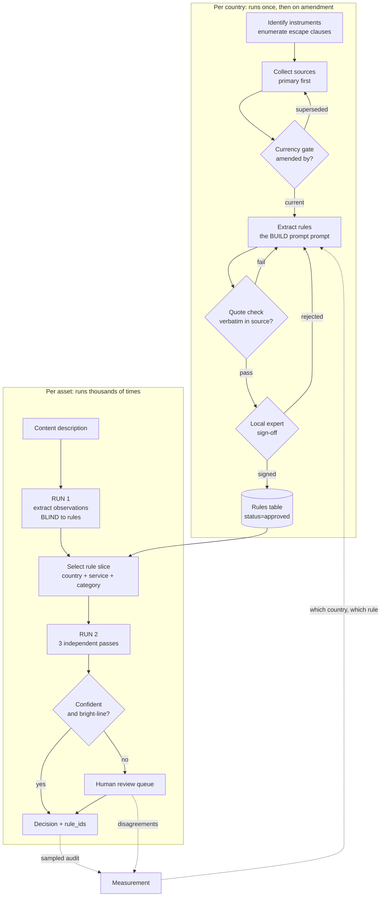

# Task 2, Scaling to dozens of countries

## What is answered where

The five questions, and the four things Task 2 asks for:

| Question | Section |
|---|---|
| 1. Source collection and validation | [1. Source collection and validation](#1-source-collection-and-validation) |
| 2. Organizing the rules | [2. Organizing the rules](#2-organizing-the-rules) |
| 3. Solution structure | [3. Solution structure](#3-solution-structure) |
| 4. Correctness testing | [4. Correctness testing](#4-correctness-testing) |
| 5. Measurement and diagnosis | [5. Measurement and diagnosis](#5-measurement-and-diagnosis) |

| Deliverable | Section |
|---|---|
| A process diagram | [Process](#process) |
| An example of how a single rule is represented | [Deliverable: how a single rule is represented](#deliverable-how-a-single-rule-is-represented) |
| A validation plan | [4. Correctness testing](#4-correctness-testing) |
| Success metrics | [5. Measurement and diagnosis](#5-measurement-and-diagnosis) |

Two sections sit outside that list because the brief also asks what needs a local expert, and
because the order countries are added in turns out to matter:
[what can be automated](#what-can-be-automated-and-what-needs-a-local-expert) and
[rollout order](#rollout-order).

---

## The claim this plan rests on

Two countries produced about twenty real defects. **Every single one was silent.** Nothing
crashed, nothing looked wrong, and not one was found by re-reading the work:

- four quotes that were paraphrases, or had punctuation I had added that cut a sentence
  before the words making the rule enforceable
- a rule carrying wording superseded by an amendment in 2014, which would have under-rated
  content
- the same mistake again, in rules written hours after I wrote down the lesson
- a whole Code section wrongly scoped out, because I tested for one phrase
- a rule that could never reach the decision engine, because it described delivery rather
  than content
- two spellings of one service name, dropping a rule from every slice that used the other
- a manifest column deleted by a script that had never heard of it
- files sitting on disk reported as missing, because a lockfile was treated as proof
- three source URLs that were dead in three different ways, all labelled "bot-blocked"

Every one was caught by a mechanical check comparing the work against something external.

So the thing to scale is **not** the rules. Rules are the easy part, they are typing. What
has to scale is the machinery that catches silent error, because at thirty countries nobody
will read the table, and an error that produces complete-looking output is indistinguishable
from correctness until a regulator says otherwise.

**Design principle: assume every country's extraction is wrong somewhere, and build the thing
that finds it.**

---

## Six problems that are new, not just bigger

A lot of scaling up is simply doing the same thing more times and watching for what breaks.
That part matters, and it is the rest of this document.

But six problems below are genuinely different. They are not bigger versions of something we
faced with two countries. With two countries they do not exist at all, which means no amount
of care in Task 1 would have found them.

Four of the six have to be built in before the third country is added. Adding them later
means going back and redoing every country already running.

### 1. Working out whose rules even apply

**The short version:** before you can apply a country's rules, you have to know which
country's rules apply. That is not always the country where people are watching, there is no
worldwide answer to it, and **I got this wrong in Task 1.**

#### The two patterns

Countries answer the question "who regulates this channel?" in one of two ways.

**Country of origin.** The channel follows the rules of the country where the company is
based, and the countries it broadcasts into have to accept that. One channel, one rulebook,
however many countries receive it.

**Country of destination.** The channel follows the rules of each country where it can be
watched, and usually needs a licence from each one. One channel, many rulebooks.

These give opposite answers, and which one you are under depends on where the company is and
which countries it reaches.

#### What I got wrong

I wrote earlier that this problem does not appear with only two countries. That was wrong, and
it is worth saying plainly because it is the kind of error this whole project is built to
catch.

The two countries in Task 1 use **opposite** systems.

- **France** is in the EU, so it is under the Audiovisual Media Services Directive, which
  works on country of origin.
- **The UK left the EU** and is now treated as an outside country by that directive. It moved
  to country of destination: a TV service available in the UK generally needs an Ofcom licence
  no matter where the company sits.

So the jurisdiction problem was sitting inside Task 1 the whole time and I did not see it. It
does not change any rule in the table, because every rule in there is a rule about content and
timing rather than about who regulates whom. It does change what the table is **for**: it is a
set of rules for channels that Ofcom regulates and channels that the French regulator
regulates, and deciding whether a given channel is one of those is a separate question nobody
has answered yet. That is now recorded as an open conflict rather than left in a document
nobody reads.

#### It is messier than two patterns, even inside Europe

The UK did not switch cleanly. It stayed in an older Council of Europe treaty, the European
Convention on Transfrontier Television, which works on a country-of-origin basis among its
members. So a UK channel going into one of those countries is still treated the origin way,
while the same channel going into an EU country that never joined that treaty needs a local
licence. Seven EU countries never joined it: Belgium, Denmark, Greece, Ireland, Luxembourg,
the Netherlands and Sweden.

That treaty also has holes. It covers ordinary broadcast TV but not video on demand and not
linear channels delivered over the internet, so a company can be under one system for its
satellite channel and another for the same content streamed. Work to update it was abandoned
years ago, so the holes are not going to close.

And when a satellite is involved and no European country licensed it, regulators have fallen
back on asking where the signal was sent up from. There is a documented case of a channel
banned in the UK setting up a chain of shell companies specifically to make that question
hard to answer.

#### A worked example, because *country B just accepts it* sounds wrong

Say Country A allows explicit nudity during the day. Country B allows it only at night. The
channel is based in Country A and people in Country B can watch it. Does Country B really
have to accept daytime nudity on its own screens?

**Broadly, yes.** The directive says member states must ensure freedom of reception and must
not restrict retransmission of services from other member states in the areas it covers. That
is not a side effect of the system, it **is** the system. Country B's stricter rule binds the
channels Country B regulates. It does not reach a channel that Country A regulates.

That feels wrong the first time you read it, and it is the single most counter-intuitive thing
about how this works. It is also why companies choose where to base themselves.

**But Country B is not completely powerless.** There are two escape hatches, and the useful
thing is how narrow they both are.

**Escape hatch 1: ask nicely.** If a channel based in Country A is wholly or mostly aimed at
Country B's audience, Country B can ask Country A to deal with it, and both countries are
required to cooperate and look for a solution. That is a request backed by an obligation to
engage. It is not a power to block.

**Escape hatch 2: the emergency brake, which exists precisely for protecting children.**
Country B can temporarily suspend a service that "manifestly, seriously and gravely" breaks
the protection-of-minors rules. Note how high that bar is set, and then look at what Country B
has to do first:

1. the channel must have done it at least **twice in the previous 12 months**
2. Country B must have warned the channel, Country A and the European Commission **in
   writing**, saying what it intends to do if it happens again
3. the channel must have been given a chance to put its side
4. talks with Country A must have failed to reach agreement within **one month**
5. only then can Country B act, and the Commission then has **three months** to decide whether
   Country B was even allowed to, after asking ERGA
6. if the Commission says no, Country B has to stop "as a matter of urgency"

So the brake is for a channel that repeatedly and seriously harms children, not for a channel
whose schedule is more relaxed than yours. **A rule that says night where theirs says day does not come
close to meeting it.**

All of that is in `EU-D1b`, which is already in `sources/originals/`, and the quoted phrases
verify against it.

**The practical upshot for the system:** a difference in rules between two countries is not
something to resolve. Most of the time there is nothing to resolve, because only one country's
rules were ever going to apply. The system's job is to work out which country that is and then
apply only that country's rules, not to compare them and pick the stricter one. Picking the
stricter one would be the obvious defensive instinct and it is wrong: it would push content
later than the law requires, which is the over-rating failure described in section 5, and
nobody would ever complain about it.

#### So yes, you need a table. Two tables, in fact

Your instinct is right, with one refinement: the thing that varies is not a single category
per channel.

**Table 1, per channel: who is its home regulator?** One row per channel, saying which country
has jurisdiction, on what basis, who confirmed it and when. For Europe this is largely a
download from MAVISE, described below, plus a lawyer confirming it. Outside Europe it is a
lawyer from the start.

| channel | home regulator | basis | confirmed by | confirmed on |
|---|---|---|---|---|
| (example shape) | Ofcom, UK | Ofcom licence, head office and editorial decisions in UK | named lawyer | date |

**Table 2, per pair of countries: does B accept A's regulator?** This is where origin and
destination actually live, because it is a property of the **relationship between two
countries**, not of the channel. Country B might accept Country A's regulator and not Country
C's, depending on which treaties each pair shares.

| home country | receiving country | B accepts A's regulator? | basis |
|---|---|---|---|
| (example shape) | | yes / no / only for some service types | treaty or national law |

Table 2 is much smaller than it looks, because it is shared across every channel. Thirty
countries means a fixed grid, filled in once per pair and revisited when a treaty changes,
rather than work that repeats per channel.

Then the lookup is: take the channel, find its home regulator in table 1, check in table 2
whether the receiving country accepts that regulator, and **apply exactly one country's
rules**, or flag that a licence is needed locally. If either table has no confirmed answer,
the system refuses to decide rather than guessing.

#### There is a public database for this, at least in Europe

The question "which country regulates this channel?" is common enough that the European Union
made answering it a legal requirement. Each country has to keep a list of the services it
regulates, and those lists have to be published together in one public place.

That place is **MAVISE**, run by the European Audiovisual Observatory. It is free, it is
updated monthly, and the data comes from the national regulators themselves rather than from
anyone's guesswork. It covers 42 European countries plus Morocco, and holds around 10,000 TV
channels and 4,600 on-demand services. You can search by channel name and read off which
country claims jurisdiction, and results download as a spreadsheet.

For our purposes that is close to the lookup table this problem needs. It does not remove the
need for a lawyer, because a database entry is a record rather than a ruling, but it turns
"nobody knows" into "here is what the regulators themselves have registered, and here is the
date it was last updated".

It also shows how far jurisdiction drifts from where people watch. In one year's figures,
**70% of cross-border TV channels in Europe fell under just three countries**: the
Netherlands, Luxembourg and Spain. More than three quarters of Luxembourg's share was there
because of where the satellite uplink sits, not because anyone in Luxembourg is watching.

**The body that handles disputes publishes too.** ERGA, the group of European regulators,
puts its documents online for free, including reports specifically on how jurisdiction is
decided. Those are general guidance rather than rulings on individual channels, so they help
you understand the test rather than telling you the answer for one channel.

**What this does not cover: everywhere else.** MAVISE is Europe. There is no worldwide
equivalent, no global registry, and no international body that settles it when two countries
disagree. So for a European country the honest plan is "look it up and have it confirmed",
and outside Europe it is "ask a local lawyer and write the answer down", which is slower and
is the real cost of going worldwide.

#### Why this gets worse worldwide, not better

Everything above is Europe, which is the part of the world with the **most** agreement. Two
overlapping treaties, a known list of who is in which, and committees to settle disputes.

Outside Europe there is no equivalent. Each country decides for itself whether it regulates by
where a company is based, by where the signal is received, by who holds the licence, or by
where a satellite uplink sits. Some have no framework for foreign channels at all. There is no
list to look this up in, and no body that resolves it when two countries disagree.

So the honest answer to "how do we handle this for thirty countries worldwide" is: **you
cannot write one rule for it.** Any system that assumes country of origin will be wrong in
every destination-based country, and the reverse.

#### What this means for the build

The system must not contain a jurisdiction rule at all. Not country of origin, not country of
destination, not anything in between.

Instead, **which rulebook applies is a stored fact per channel per territory**, decided by a
lawyer once and written down, exactly like the other channel-level facts described in section
3. The row records which regulator claims the channel, under what legal basis, and when that
was last confirmed.

Three consequences:

1. **The decision is keyed to a rulebook, not a country.** "Apply the UK rules" and "this is
   being watched in the UK" are different statements and the system must not treat them as the
   same one.
2. **The answer can be more than one rulebook.** A channel can owe duties in several places at
   once, and the safe reading is the strictest of them. The system should be able to return
   several and say so, rather than picking one.
3. **"We do not know" is a required answer.** If no confirmed rulebook is recorded for a
   channel in a territory, the system must refuse to decide and say why. Guessing here is
   worse than guessing a time, because every rule that follows is drawn from the wrong book
   and the answer still arrives with citations attached.

This also explains why it has to be designed in before country three. A table keyed on
`country` works fine until the first channel that is regulated somewhere other than where it
is watched, and then every row and every stored decision has to be revisited.

**On sourcing:** the facts in this section come from web research, including Ofcom's own
post-Brexit licensing guidance and the text of the Council of Europe treaty. None of those
documents is in `sources/originals/`, so by this project's own rule nothing here may become a
rule in the table until they are collected and quote-checked like every other source.

### 2. Finding enough experts is what actually limits you

Reading a law and writing down its rules is the cheap part, and it keeps getting cheaper.
Having someone qualified confirm that you read it correctly does not get cheaper.

Every country needs a person who knows that country's broadcasting rules well enough to say
"yes, that is what this means here". Thirty countries means thirty such people, each of whom
also has to agree to a turnaround time when a law changes, because a law can change at any
time and a rule nobody has re-checked is a guess.

Finding and keeping those thirty people is a hiring problem, not a software problem, and it is
the thing that really caps how many countries you can cover. However fast the software gets,
a country cannot go live until someone has signed off its rules. So plan it as a staffing
list with real names against each country, and treat an empty seat as a reason not to launch
there rather than as a task for later.

### 3. Legal changes go from being events to being a constant stream

With two countries, a law changing is an event. It happens, you notice, you deal with it.

With thirty countries, each relying on several documents, something somewhere is always
changing. It stops being an event and becomes a steady stream of work, and a steady stream
needs sorting, because some changes matter immediately and some can wait.

The useful way to sort them is by what the change touches. If it changes a clear-cut rule that
decisions are actually using, it is urgent, and the system should stop giving automatic
answers that depend on that rule until it is updated. If it changes a rule that no decision
has used in six months, it can wait for the next scheduled review. The system already records
which rules each decision used, so a computer can do this sorting. Nobody has to judge it.

### 4. You stop being able to read your own sources

With two countries I could read both. The one place where I had to rely on a translation is
flagged in the table as a known weakness.

With thirty, most of the laws will be in languages nobody on the team reads. Some will be in
alphabets that are not the Latin one, some will read right to left, and some will be scanned
documents where the computer's copy of the text is wrong even though the page looks fine.

The good news is that the quote checker still works. It compares the quote we wrote down
against the stored document letter by letter, and that comparison does not care what language
either is in.

The bad news is that this guarantee is smaller than it sounds. It proves the quote was copied
correctly. It cannot prove we picked the right sentence, or that two lines later the law says
"except when...", or that a word with a special legal meaning means what a dictionary says it
means. **The automatic checks survive the language barrier. Human judgement does not.** That
is exactly why point 2 above, finding experts, is the real limit.

### 5. One country going wrong must not take down the rest

With two countries, if the table is wrong you stop and fix it.

With thirty, a problem in one country must not break the other twenty-nine. Just as important,
it must not be *hidden* by the other twenty-nine. If you only look at the overall score, 96%
correct could be twenty-nine countries at 99% and one country at 20%. The overall number looks
healthy while one market is being answered close to randomly.

Two things follow. First, every measurement is reported per country and never only as a
combined figure. Second, each country needs its own automatic stop: if its test results drop
below an agreed level, that country stops giving automatic answers and sends everything to a
person, while the other countries carry on as normal. This has to be designed in early,
because it changes how results are stored.

### 6. Changing the shape of the table stops being easy

The rules table has a fixed set of columns. Adding a new column, or changing what one means,
is an afternoon's work when there are two countries in it.

With thirty countries it is a much bigger job. Every country's rows have to be updated, and
for each country the expert may need to look again at the rows that changed, because a column
that means something slightly different is a row that has not really been checked.

So the table's shape needs a version number, and every row needs to record which version it
was written under. That way a change can be rolled out one country at a time instead of
having to happen everywhere at once.

This is the real reason for the rollout advice further down. If the shape of the table is
still changing by the tenth country, every country added after that inherits the problem and
every country added before it has to be revisited.

---

## And then the part that is just more of the same

The rest of this document is the Task 1 flow run thirty times. The fourteen steps in
`HOW_IT_WORKS.md` do not change; what changes is which of them breaks first and what has to be
true before country three rather than after country thirty.

| This document asks about | Which steps |
|---|---|
| Source collection and validation | 1, 2, 3 |
| Rule representation | 4 |
| Testing for correctness | 5, 6, 13 |
| Automate versus local expert | 7, and the model-versus-code audit throughout |
| Shared versus country-specific | 11 |
| Measurement and diagnosis | 14 |

## Process



Two loops at different speeds. The left runs once per country and again whenever the law
changes. The right runs per asset. **They must not be merged**, a system that reads
regulation and applies it in one step has nothing separating "what the rule says" from "what
I decided", so a misreading is unfalsifiable.

---

## 1. Source collection and validation

### Primary sources only, with everything else labelled

Rank each source 1-7: statute, regulator binding instrument, regulator guidance, enforcement
precedent, regulator summary, classification body, secondary. Conflicts resolve by lowest
number. **A rule whose only proof quote comes from rank 5 or below is an inference, and the
row must say so.** One row in the current table is exactly this and is flagged accordingly.

### The amendment problem, which is the one that will bite at scale

Two of the worst defects in Task 1 were the same error: a rule whose text had been amended,
where the table carried the old wording. The second occurred *hours after* I documented the
first.

It is hard to catch because the old version is **internally coherent and corroborated**. The
English translation and the pre-amendment French agreed with each other, both were simply
out of date. **Cross-checking sources does not catch this.** Only reading the amending
instrument does.

At thirty countries this is the single highest-volume failure. Requirements:

- every source row carries `amended_by` and `amendments_checked_on`
- **no rule may be `approved` while citing guidance older than the most recent amendment to
  the rule it interprets**, enforced in CI, not by discipline
- subscribe to each regulator's publication feed; an amendment moves every rule citing it to
  `needs_recheck` automatically
- consolidated text only. Original-publication URLs belong on superseded rows

An amendment also has to reach anything that **stored** an answer. If decisions are cached to
keep the cost per title down, every stored answer must record the `rule_id`s it relied on, so
an amendment drops exactly the answers that cite a rule from the amended document and leaves
the rest alone. A blanket flush on any amendment anywhere means that at thirty countries the
cache is cold almost all the time and was never worth building. The cache design, including
why the key cannot be the content alone and why a similarity threshold has to be validated on
adversarial pairs rather than random ones, is in `HOW_IT_WORKS.md` under steps 0b to 0d.

**And an amendment is free information about itself.** When an amendment drops a set of stored
answers, keep a sample and re-decide those from scratch under the new rules, then compare them
with what was being served.

Identical means the amendment did not touch anything that mattered in practice, which is worth
knowing and is otherwise very hard to find out. Different means the cache was serving stale
law, and the comparison tells you **exactly which answers were wrong, in which direction, and
since when**, which is the first thing anyone will ask and normally the thing nobody can
answer. The sample costs a handful of decisions per amendment, and it is the only mechanism
here that measures the real-world impact of a legal change rather than just reacting to it.

It doubles as a regression test nobody has to write. The comparison is between two runs of the
same system over the same input with only the rules changed, so any difference is attributable
to the amendment or to non-determinism, and both are things you want to see.

### Contradictions, translation, and gaps

The brief asks about three things that all have the same shape: the source does not give you
a clean answer. Each needs a different response, and none of them is "pick the likeliest".

**Contradictions between sources.** Two documents say different things. Resolve by rank: the
lower the number in the list above, the more it counts, so a binding instrument beats a
guidance note and both beat a summary page. This is not theoretical. The French regulator's
own public summary page contradicted its binding text about which hours applied, and the
binding text won. **Record the losing reading too**, in the row's note. If someone later asks
why the summary page says otherwise, the answer is already written down.

**Translation.** Only the original language is legally authentic. Where we work from a
translation, the row says so, and a reviewer who reads the original has to re-check it. The
quote we store is the original-language quote, not the translated one, because that is the
text the law actually consists of. The translation goes alongside it for readers. This is a
live weakness here: the French rules are quoted from an official English translation that
states only the French is authentic.

**Missing information, meaning the source does not settle the question.** This is the one
people get wrong. There are three different situations and they are not interchangeable:

| situation | what it means | what to do |
|---|---|---|
| The document does not mention it | The law is genuinely silent | Do not write a rule. Silence is not permission and it is not prohibition. Log it as a question for the local expert |
| The document mentions it but is vague | The law leaves it to judgement | Write the rule, mark it as needing judgement, and route it to a person every time |
| We could not read it properly | Our problem, not the law's | Mark the row unverified and do not let it reach a decision until someone has read it |

Writing a confident rule for any of the three is worse than writing none, because a rule in
the table gets used. The worst habit to allow is filling a gap with what the neighbouring
country does.

### Link health, honestly

Three URLs failed in three different ways and I had labelled all three "bot-blocked". From
inside an automated environment a dead hostname, a retired path and a rejected query all look
identical, a failed fetch. Record the **observed** failure, and where no cause was observed
say "cause not established" rather than guessing the host's usual excuse.

Store a hash and the retrieval date for every document. Re-fetch quarterly; a changed hash
means the law may have moved.

### Verify the file is the document

A saved page can hold nothing but the website's menus, headings and links and still look plausible by size, one was 12,493
characters of menus and passed a length check. Every source carries an `expect` phrase that
only the real document contains, checked on save and on import.

**And make it a phrase that identifies that document.** Several of mine did not: one matched
five of twenty-two files, one matched only the *wrong* document, because two unrelated
guidance notes both said "Issue Six".

---

## 2. Organizing the rules

One row per operative rule. The schema is the same in every country; only the values differ.

| field | why it exists |
|---|---|
| `rule_id`, `country`, `clause_ref` | citation that resolves to a line in a document |
| `authority_rank` | conflict resolution |
| `service_type` | **controlled vocabulary, enforced in CI** |
| `content_category` | controlled vocabulary |
| `classification` | the label this country issues, or `none` |
| `time_rule_machine` | parseable hours |
| `other_restriction` | access control, signage, warnings, adjacency, quotas |
| `exceptions_conditions` | derogations and allowances |
| `determinacy` | `bright_line` / `conditional` / `judgment_based` |
| `ambiguity_flag` | `clear` / `conflicting_sources` / `translation_uncertain` / `unverified` |
| `verbatim_quote` | the proof |
| `amended_by`, `valid_from` | currency |
| `examples` | the regulator's own worked examples |

### Validity dates, so an old decision can still be explained

Every row carries the date its wording took effect (`valid_from`) and, once replaced, the date
it stopped applying (`valid_to`) with its status set to `superseded`.

**Rows are never deleted.** That is the whole point. If a regulator asks in two years why a
programme was scheduled the way it was, the answer has to be the rule as it stood *on the day
it was broadcast*, not the rule as it stands now. Delete the old row and that question becomes
unanswerable. Keep it, and a decision from last year can be replayed exactly.

So a decision stores the rule versions it used, not just the rule IDs. The same ID can mean
two different things a year apart, and "we applied rule FR-SCH-003" is not an answer unless
you can say which version of it.

This also makes a legal change measurable rather than just disruptive: with both versions on
hand you can re-run old decisions under the new wording and see which ones change. That idea
is described under the amendment problem above.

**Honest caveat:** no rule in the current table has actually been through this. Nothing was
amended during the project, so every row is a first version and the `superseded` path has
never carried anything. It is written and untested.

### Three distinctions that must not collapse

**Determinacy is not ambiguity.** One describes the rule, the other describes my confidence
in reading it. A crisp rule I am unsure I transcribed is `bright_line` + `unverified`. Merge
them and you lose the ability to express that.

**Rating, hours and other restrictions are three axes, and they are substitutes.** One rule
reads `any_time; requires=mandatory_daytime_protection`; another disapplies the watershed
entirely while that gate is on. A two-axis model reports "any time" and drops the condition
that earned it, **wrong, not merely incomplete.** This is not a quirk: the EU framework
requires an *outcome* and permits scheduling **or** technical measures as alternatives, so
every country implementing it will show the same shape.

**Allowances are rules too.** A table of prohibitions over-restricts, which costs
distribution for no compliance benefit.

### Controlled vocabularies, enforced

`service_type` was uncontrolled and the same service was spelled two ways, silently dropping
a rule from every decision slice using the other spelling. Nothing failed; a rule was just
missing. The verifier now rejects any token outside the list. **Do this for every enumerated
field before country three, not after country thirty.**

---

## Deliverable: how a single rule is represented

One rule, followed from the law to a decision. This is the worked example Task 2 asks for.

Take the French category III restriction.

**Collect.** Arcom recommendation, consolidated. Rank 2. Check `amended_by`, a 2014
instrument broadened the category definition, so the consolidated text is required and the
original would under-rate. *This is the exact mistake that reached my table.*

**Extract.**

```
rule_id          FR-SCH-003
authority_rank   2
service_type     other_than_cinema_channels
content_category violence
classification   III_-12
time_rule_machine not_before=22:00
exceptions_conditions  derogation after 20:30 except Tue/Fri/Sat/holiday-eve/school
                       holidays; annual_quota=16; sub_quota=4 cinema-banned-to-under-12s
determinacy      bright_line
verbatim_quote   "réservés à un public averti … après 22 h 30 sur les autres services"
amended_by       délibération 2014-17
```

**Check.** Quote must appear in the stored file. Two French rows failed this and turned out
to be paraphrased from a government summary rather than the instrument.

**Sign off.** A French media lawyer confirms the quota interacts with the derogation as
modelled, and that the 2014 broadening is captured.

**Use.** A title with sustained violence, on a general channel, Wednesday 20:45 → the
derogation is available, Wednesday is not excluded, but it consumes one of sixteen. The
decision cites `FR-SCH-003` and reports the quota consumption, because a quota silently
exhausted in week nine is a breach in week ten.

**Monitor.** If reviewers keep overturning this rule, the threshold is miscalibrated.

---

---

## 3. Solution structure

**Shared, build once:**

the schema and vocabularies; the extraction prompt; the quote checker; the currency gate; the
decision engine and its three passes; conflict resolution by authority rank; the
review-queue; metrics; the rule that service type is never assumed.

**Country-specific, the data only:**

the instruments, the categories, the hours, the escape clauses, the vocabulary mappings.

### A third level the first draft missed: channel

Two levels, shared and country, do not fit the facts. The Toofan decision turned partly on
the broadcast falling during Eid-ul-Adha, because **that channel serves a Muslim audience**.
The identical date on a different channel in the same country, under identical law, carries
no such weight.

That is not shared logic and it is not country data. It is **channel** data, and it cannot be
researched centrally or derived from a public-holiday calendar. A system that infers festival
dates from a country table will be wrong in both directions: flagging dates that do not matter
for that audience, and missing ones that do.

| level | example | who owns it | how often it changes |
|---|---|---|---|
| shared | the schema, the quote checker, three-pass decisions | platform team | rarely |
| country | instruments, categories, hours, escape clauses | local lawyer | on amendment |
| **channel** | high-child-audience dates, whether a +1 exists, the service's type under local rules, any channel-specific agreement with the regulator | the channel's own compliance contact | annually |

Channel data is small, perhaps ten to twenty dates and a handful of flags per channel, but it
cannot be bought, scraped or inferred. **This changes the staffing model.** "One lawyer per
country" does not cover it; you also need a named contact per channel, and the thing you need
from them takes an hour a year, not a retainer.

In France this level already exists formally: each channel's convention with the regulator can
be stricter than the general law. The same shape, arrived at from a different direction.

**The dangerous middle: what looks shared and is not.**

- *"There is an age rating."* The UK issues **none** for linear TV. A shared model with a
  mandatory rating field will make one up.
- *"The watershed is a time."* It is 21:00, or 20:00 on unprotected premium film services, or
  disapplied entirely behind a gate.
- *"Hours depend on the rating."* In France they depend on service type and weekday.
- *"A decision is about a programme."* It is not. It is about **a transmission**. A +1
  service re-broadcasts the same file an hour later, so content placed while children are at
  school lands after they are home, identical file, identical channel brand, different
  answer. One programme shown four times is four decisions. A data model keyed to the asset
  cannot represent this at all, and the error is invisible because the asset passed.
- *"Scope is obvious."* I scoped the Code by one phrase and wrongly excluded a whole section
  that enters through a different door, a context clause that imports time of broadcast.
  **Scope every country by enumerating its escape clauses, not by searching for a phrase.**

Represent these as data, not code. The engine should never contain the string `2100`.

---

## 4. Correctness testing

### Who approves the right answers, and why it cannot be us

A test set is only worth as much as the answers in it. If the person who built the system also
decides what the correct answers are, the tests prove the system agrees with its author. They
prove nothing about the law.

That is not hypothetical, it is the state of Task 1. I wrote the rules, the prompts, the test
cases and the checker, and I ran them. **Every passing test in Task 1 should be discounted on
that basis.** The failures are the trustworthy part, because a system rarely fails in a way
its author expected.

So, at scale:

| who | what they approve | why them |
|---|---|---|
| The country's expert | The correct answer for every test case in their country | They are the only person who can say what the regulator would actually do |
| A second person, who has not seen the rules table | The clear-cut rules, re-derived from the original laws | Catches the case where the table and the tests share one misreading |
| The channel's compliance contact | Anything resting on facts about that channel | Those facts cannot be researched centrally. See the channel level in section 3 |

The second row is the important one and the easiest to skip. If the same person writes the
rule and writes the test answer, a misreading appears in both and they agree with each other
forever. The test passes, and it passes *because* the error is in both places. Nothing inside
the system can detect this. The only fix is a second person deriving the rules from the
original laws without seeing what we wrote, and then comparing. Where the two disagree, treat
it as a finding about **both**, not as the second person being wrong.

This costs real money and it is the first thing that gets cut. Budget it per country from the
start, because if it is not in the plan at country three it will never be added by country
thirty.

### Building the set

**Golden set per country.** 30-50 assets with expert-agreed answers. Build them to *break*
the system: in Task 1, five cases found two real bugs, and the productive pair were the same
film with **identical content** on different services, any system deriving hours from the
rating must answer both alike and must therefore be wrong about one.

**Negative-space cases.** The hardest case had no violence, sex, drugs or language and still
breached, because the trigger was *treatment*. A test set of obviously-spicy content will
miss an entire rule class.

**Independent re-derivation.** For bright-line rules, have someone who has **not seen the
table** derive them from sources and diff. This is the only defence against correlated error,
where the extractor and the checker share a misreading and agree with each other.

**Back-testing.** Replay past enforcement decisions. If the system clears something a
regulator fined, that is the strongest signal available.

**Mutation testing.** Corrupt a rule deliberately, change 22:00 to 20:00, and confirm the
golden set fails. If it still passes, the test set does not exercise that rule.

**Report every check's denominator beside its result.** This one cost weeks here. The quote
check reported "50 verified, 0 failed, 0 skipped" and that read as full coverage; in fact only
50 of 102 rules carried a quote and the rest were passed over in silence, because the check
iterated the rules that had one. Six of the unchecked were absolute prohibitions. **A coverage
number that counts only the rows which opted in will always report success.** At thirty
countries nobody will notice. Print the denominator, and fail the build when a rule class that
must be checked is not.

**CI, non-negotiable:** quote integrity, vocabulary conformance, currency gate, schema
validation, and a regenerate-and-diff of the CSV mirrors so a binary table cannot drift.

---

## 5. Measurement and diagnosis

Measure in two directions: **is it right**, and **is it useful**.

### The three ways of being wrong are not equally bad

"Wrong" is too coarse to act on. A wrong answer here is wrong in one of three ways, and they
cost completely different things, so they get separate numbers and separate targets.

| how it is wrong | what it means | what it costs | target |
|---|---|---|---|
| **Under-rating** | The system was more permissive than the rule. It cleared something for an earlier slot or a wider audience than it should have | A possible breach. Fines, on-air apologies, licence trouble. This is the one that ends careers | **under 0.5%, and every single one reviewed individually** |
| **Over-rating** | The system was stricter than the rule. It pushed something later or added a condition that was not required | Lost audience and lost money, quietly. Nobody complains, so nobody finds out | under 5% |
| **Wrong hours** | The rating was right but the permitted times were not | Either of the above depending on direction, and this is the most common one in practice because hours depend on things the rating does not | under 2%, split by direction |

**Never report these as one number.** They point in opposite directions. A system tuned to
avoid under-rating will over-rate constantly, and a combined accuracy figure will look stable
while the business quietly loses slots. Both numbers have to be visible at once, and
over-rating needs its own owner, because under-rating complains about itself and over-rating
never does.

Wrong hours gets its own line because of something Task 1 found the hard way: the rating does
not predict the hours. The same rating gives different times on different service types and
different weekdays, and one country issues no per-programme rating at all. A system can get
the rating exactly right and the hours completely wrong, and measuring only "accuracy" hides
that entirely.

### Telling a content mistake apart from a rules mistake

This is the question that decides who fixes a problem, and the whole two-stage design exists
to make it answerable.

The system reads the content in one step (RUN 1) and applies the rules in a separate step
(RUN 2), and RUN 1 does not know the rules exist. So when an answer is wrong, there is a
clean test:

> Take the corrected description, the one a person fixed by hand, and run **only** the second
> step again on it.
>
> - **The answer comes out right.** The rules were fine. The system misread the content. Fix
>   belongs in RUN 1 or in the description it was given.
> - **The answer is still wrong.** The content was read correctly and the rules were applied
>   wrongly, or the rule itself is wrong. Fix belongs in the table or in RUN 2.

That one re-run splits every failure into two piles, and the piles go to different people. A
misreading is a prompt problem. A misapplication is a rules problem and usually needs the
country's expert.

Without the separation you cannot do this. A single step that reads the law and the content
together gives you one wrong answer and no way to say which half caused it, so every failure
turns into an argument.

### Everything else

| metric | target | what it tells you |
|---|---|---|
| Decisions overturned at review | < 5% | correctness overall, before splitting as above |
| Quote integrity | 100% | nothing drifted |
| Rules citing stale guidance | 0 | the amendment loop works |
| Sources past re-check date | 0 | collection is alive |
| Escalation rate | 15-30% | **both directions are bad** |
| Golden-set pass rate | > 95% | regression |
| Coverage gaps per 100 assets | trending down | rules missing from the table |
| Time to propagate an amendment | < 5 working days | responsiveness |

**Escalation rate is the honest one.** Too high and nobody is saved work. Too low and it is
guessing at judgment calls. The number alone means nothing, segment it.

**Diagnosis has to localise.** Every decision carries `rule_id`s, so an overturn points at a
rule, not at "the model". Then:

- one rule, one country → threshold miscalibrated
- one rule, every country → shared logic bug
- one country, many rules → extraction or translation problem at the source
- observation absent entirely → RUN 1 failure, not a rules problem
- no rule matched → a genuine coverage gap; log it as a rule to collect

Track **coverage gaps** explicitly. An observation matching no rule is information, not noise.

---

## What can be automated, and what needs a local expert

**Automate:** fetching and hashing; currency and link checks; quote integrity; vocabulary and
schema conformance; first-pass extraction; rule selection; applying bright-line rules;
routing; metrics; amendment alerts.

**Needs a human, but not a lawyer:** the channel-level data above. High-child-audience
dates, whether a +1 service exists, the channel's service type under local rules. The
channel's own compliance contact knows these; no amount of research reproduces them. Budget an
hour a year per channel, not a retainer.

**Local expert, always:**

- **Sign-off before any rule goes live.** Non-negotiable. An unreviewed extraction is a
  hypothesis.
- **Calibrating judgment rules.** 38 of 103 current rules are judgment-based with one
  enforcement precedent between them. The table can say a judgment is needed; it cannot say
  where the line sits. Only someone who has argued these cases can.
- **Unwritten regulator practice.** What a regulator tolerates is not in the text.
- **Translation.** French rules here are quoted from an official *English translation* that
  states only the French is authentic.
- **Channel-level agreements.** In France each channel's convention with the regulator can be
  stricter than the law. These are per-channel and cannot be scraped.
- **Anything irreversible.** Pulling a title, or clearing one with regulatory exposure.

**The division:** automation decides *whether a question is hard*; experts answer the hard
ones. The system's job is to make the easy 70% cheap and route the rest with the rule and the
quote already attached, so the expert starts from evidence instead of a blank page.

---

## Rollout order

**Countries 3-5: deliberately slow.** The goal is not coverage, it is discovering which
assumptions were UK/France-specific. Pick maximally different frameworks, one with a real
per-programme rating, one with no watershed, one non-EU, because similar countries will
confirm wrong assumptions rather than expose them.

**Countries 6-15:** the schema should be stable. Each new country should cost extraction plus
expert review and nothing else. **If you are still changing the schema at country ten, stop
and fix it**, every later country inherits the flaw.

**Countries 16+:** the bottleneck becomes expert availability and amendment monitoring, not
extraction.

**Stop adding countries when** amendment lag exceeds a month, or the overturn rate rises as
countries are added. The second means the schema is absorbing differences it cannot express,
and more countries will make it worse.

---

## What I would tell whoever builds this

Build the quote checker on day one, before any rules exist. In Task 1 it caught four fabricated
or misattributed quotes within seconds of the real sources arriving, including one where I had
added a full stop that cut a sentence before the words that made the rule enforceable. I would
never have found that by reading.

Then accept the uncomfortable part: **the author cannot be the grader.** I wrote the rules,
the tests and the checker, and I executed them. The only results from Task 1 worth trusting
are the failures, because those survived my bias rather than being produced by it. At thirty
countries, that problem is thirty times larger and the only real answer is independent
re-derivation.
