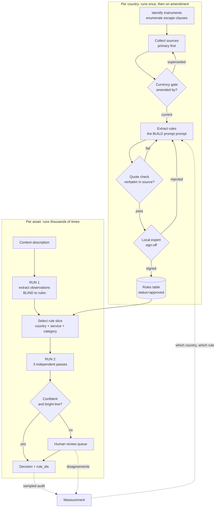

# Task 2, Scaling to dozens of countries

## The claim this plan rests on

Two countries produced about twenty real defects. **Every single one was silent.** Nothing
crashed, nothing looked wrong, and not one was found by re-reading the work:

- four quotes that were paraphrases, or had punctuation I had added that cut a sentence
  before the words making the rule enforceable
- a rule carrying wording superseded by an amendment in 2014, which would have under-rated
  content
- the same mistake again, in rules written hours after I wrote down the lesson
- a whole Code section wrongly scoped out, because I tested for one phrase
- a rule that could never reach the decision engine, because it described delivery rather
  than content
- two spellings of one service name, dropping a rule from every slice that used the other
- a manifest column deleted by a script that had never heard of it
- files sitting on disk reported as missing, because a lockfile was treated as proof
- three source URLs that were dead in three different ways, all labelled "bot-blocked"

Every one was caught by a mechanical check comparing the work against something external.

So the thing to scale is **not** the rules. Rules are the easy part, they are typing. What
has to scale is the machinery that catches silent error, because at thirty countries nobody
will read the table, and an error that produces complete-looking output is indistinguishable
from correctness until a regulator says otherwise.

**Design principle: assume every country's extraction is wrong somewhere, and build the thing
that finds it.**

---

## How this maps onto what already exists

Task 2 does not introduce new steps. The seven steps in `HOW_IT_WORKS.md` are all Task 1, and
each section below is a question about one of them:

| This document asks about | Which step |
|---|---|
| Source collection and validation | 1, and the currency gate added to 3 |
| Rule representation | 2 and 4 |
| Shared versus country-specific | 4 and 6 |
| Testing for correctness | 3 |
| Measurement and diagnosis | 8 |
| Automate versus local expert | 8 |

So the honest framing is not "here is a bigger system". It is: here are the seven steps run
thirty times, here is which of them breaks first, and here is what has to be true before the
third country is added rather than after the thirtieth.

## Process



Two loops at different speeds. The left runs once per country and again whenever the law
changes. The right runs per asset. **They must not be merged**, a system that reads
regulation and applies it in one step has nothing separating "what the rule says" from "what
I decided", so a misreading is unfalsifiable.

---

## 1. Source collection and validation

### Primary sources only, with everything else labelled

Rank each source 1-7: statute, regulator binding instrument, regulator guidance, enforcement
precedent, regulator summary, classification body, secondary. Conflicts resolve by lowest
number. **A rule whose only proof quote comes from rank 5 or below is an inference, and the
row must say so.** One row in the current table is exactly this and is flagged accordingly.

### The amendment problem, which is the one that will bite at scale

Two of the worst defects in Task 1 were the same error: a rule whose text had been amended,
where the table carried the old wording. The second occurred *hours after* I documented the
first.

It is hard to catch because the old version is **internally coherent and corroborated**. The
English translation and the pre-amendment French agreed with each other, both were simply
out of date. **Cross-checking sources does not catch this.** Only reading the amending
instrument does.

At thirty countries this is the single highest-volume failure. Requirements:

- every source row carries `amended_by` and `amendments_checked_on`
- **no rule may be `approved` while citing guidance older than the most recent amendment to
  the rule it interprets**, enforced in CI, not by discipline
- subscribe to each regulator's publication feed; an amendment moves every rule citing it to
  `needs_recheck` automatically
- consolidated text only. Original-publication URLs belong on superseded rows

### Link health, honestly

Three URLs failed in three different ways and I had labelled all three "bot-blocked". From
inside an automated environment a dead hostname, a retired path and a rejected query all look
identical, a failed fetch. Record the **observed** failure, and where no cause was observed
say "cause not established" rather than guessing the host's usual excuse.

Store a hash and the retrieval date for every document. Re-fetch quarterly; a changed hash
means the law may have moved.

### Verify the file is the document

A saved page can be entirely navigation and still look plausible by size, one was 12,493
characters of menus and passed a length check. Every source carries an `expect` phrase that
only the real document contains, checked on save and on import.

**And make it a phrase that identifies that document.** Several of mine did not: one matched
five of twenty-two files, one matched only the *wrong* document, because two unrelated
guidance notes both said "Issue Six".

---

## 2. Rule representation

One row per operative rule. The schema is the same in every country; only the values differ.

| field | why it exists |
|---|---|
| `rule_id`, `country`, `clause_ref` | citation that resolves to a line in a document |
| `authority_rank` | conflict resolution |
| `service_type` | **controlled vocabulary, enforced in CI** |
| `content_category` | controlled vocabulary |
| `classification` | the label this country issues, or `none` |
| `time_rule_machine` | parseable hours |
| `other_restriction` | access control, signage, warnings, adjacency, quotas |
| `exceptions_conditions` | derogations and allowances |
| `determinacy` | `bright_line` / `conditional` / `judgment_based` |
| `ambiguity_flag` | `clear` / `conflicting_sources` / `translation_uncertain` / `unverified` |
| `verbatim_quote` | the proof |
| `amended_by`, `valid_from` | currency |
| `examples` | the regulator's own worked examples |

### Three distinctions that must not collapse

**Determinacy is not ambiguity.** One describes the rule, the other describes my confidence
in reading it. A crisp rule I am unsure I transcribed is `bright_line` + `unverified`. Merge
them and you lose the ability to express that.

**Rating, hours and other restrictions are three axes, and they are substitutes.** One rule
reads `any_time; requires=mandatory_daytime_protection`; another disapplies the watershed
entirely while that gate is on. A two-axis model reports "any time" and drops the condition
that earned it, **wrong, not merely incomplete.** This is not a quirk: the EU framework
requires an *outcome* and permits scheduling **or** technical measures as alternatives, so
every country implementing it will show the same shape.

**Allowances are rules too.** A table of prohibitions over-restricts, which costs
distribution for no compliance benefit.

### Controlled vocabularies, enforced

`service_type` was uncontrolled and the same service was spelled two ways, silently dropping
a rule from every decision slice using the other spelling. Nothing failed; a rule was just
missing. The verifier now rejects any token outside the list. **Do this for every enumerated
field before country three, not after country thirty.**

---

## 3. Shared versus country-specific

**Shared, build once:**

the schema and vocabularies; the extraction prompt; the quote checker; the currency gate; the
decision engine and its three passes; conflict resolution by authority rank; the
review-queue; metrics; the rule that service type is never assumed.

**Country-specific, the data only:**

the instruments, the categories, the hours, the escape clauses, the vocabulary mappings.

### A third level the first draft missed: channel

Two levels, shared and country, do not fit the facts. The Toofan decision turned partly on
the broadcast falling during Eid-ul-Adha, because **that channel serves a Muslim audience**.
The identical date on a different channel in the same country, under identical law, carries
no such weight.

That is not shared logic and it is not country data. It is **channel** data, and it cannot be
researched centrally or derived from a public-holiday calendar. A system that infers festival
dates from a country table will be wrong in both directions: flagging dates that do not matter
for that audience, and missing ones that do.

| level | example | who owns it | how often it changes |
|---|---|---|---|
| shared | the schema, the quote checker, three-pass decisions | platform team | rarely |
| country | instruments, categories, hours, escape clauses | local lawyer | on amendment |
| **channel** | high-child-audience dates, whether a +1 exists, the service's type under local rules, any channel-specific agreement with the regulator | the channel's own compliance contact | annually |

Channel data is small, perhaps ten to twenty dates and a handful of flags per channel, but it
cannot be bought, scraped or inferred. **This changes the staffing model.** "One lawyer per
country" does not cover it; you also need a named contact per channel, and the thing you need
from them takes an hour a year, not a retainer.

In France this level already exists formally: each channel's convention with the regulator can
be stricter than the general law. The same shape, arrived at from a different direction.

**The dangerous middle: what looks shared and is not.**

- *"There is an age rating."* The UK issues **none** for linear TV. A shared model with a
  mandatory rating field will make one up.
- *"The watershed is a time."* It is 21:00, or 20:00 on unprotected premium film services, or
  disapplied entirely behind a gate.
- *"Hours depend on the rating."* In France they depend on service type and weekday.
- *"A decision is about a programme."* It is not. It is about **a transmission**. A +1
  service re-broadcasts the same file an hour later, so content placed while children are at
  school lands after they are home, identical file, identical channel brand, different
  answer. One programme shown four times is four decisions. A data model keyed to the asset
  cannot represent this at all, and the error is invisible because the asset passed.
- *"Scope is obvious."* I scoped the Code by one phrase and wrongly excluded a whole section
  that enters through a different door, a context clause that imports time of broadcast.
  **Scope every country by enumerating its escape clauses, not by searching for a phrase.**

Represent these as data, not code. The engine should never contain the string `2100`.

---

## 4. One rule, end to end

Take the French category III restriction.

**Collect.** Arcom recommendation, consolidated. Rank 2. Check `amended_by`, a 2014
instrument broadened the category definition, so the consolidated text is required and the
original would under-rate. *This is the exact mistake that reached my table.*

**Extract.**

```
rule_id          FR-SCH-003
authority_rank   2
service_type     other_than_cinema_channels
content_category violence
classification   III_-12
time_rule_machine not_before=22:00
exceptions_conditions  derogation after 20:30 except Tue/Fri/Sat/holiday-eve/school
                       holidays; annual_quota=16; sub_quota=4 cinema-banned-to-under-12s
determinacy      bright_line
verbatim_quote   "réservés à un public averti … après 22 h 30 sur les autres services"
amended_by       délibération 2014-17
```

**Check.** Quote must appear in the stored file. Two French rows failed this and turned out
to be paraphrased from a government summary rather than the instrument.

**Sign off.** A French media lawyer confirms the quota interacts with the derogation as
modelled, and that the 2014 broadening is captured.

**Use.** A title with sustained violence, on a general channel, Wednesday 20:45 → the
derogation is available, Wednesday is not excluded, but it consumes one of sixteen. The
decision cites `FR-SCH-003` and reports the quota consumption, because a quota silently
exhausted in week nine is a breach in week ten.

**Monitor.** If reviewers keep overturning this rule, the threshold is miscalibrated.

---

## 5. Testing for correctness

**Golden set per country.** 30-50 assets with expert-agreed answers. Build them to *break*
the system: in Task 1, five cases found two real bugs, and the productive pair were the same
film with **identical content** on different services, any system deriving hours from the
rating must answer both alike and must therefore be wrong about one.

**Negative-space cases.** The hardest case had no violence, sex, drugs or language and still
breached, because the trigger was *treatment*. A test set of obviously-spicy content will
miss an entire rule class.

**Independent re-derivation.** For bright-line rules, have someone who has **not seen the
table** derive them from sources and diff. This is the only defence against correlated error,
where the extractor and the checker share a misreading and agree with each other.

**Back-testing.** Replay past enforcement decisions. If the system clears something a
regulator fined, that is the strongest signal available.

**Mutation testing.** Corrupt a rule deliberately, change 22:00 to 20:00, and confirm the
golden set fails. If it still passes, the test set does not exercise that rule.

**Report every check's denominator beside its result.** This one cost weeks here. The quote
check reported "50 verified, 0 failed, 0 skipped" and that read as full coverage; in fact only
50 of 102 rules carried a quote and the rest were passed over in silence, because the check
iterated the rules that had one. Six of the unchecked were absolute prohibitions. **A coverage
number that counts only the rows which opted in will always report success.** At thirty
countries nobody will notice. Print the denominator, and fail the build when a rule class that
must be checked is not.

**CI, non-negotiable:** quote integrity, vocabulary conformance, currency gate, schema
validation, and a regenerate-and-diff of the CSV mirrors so a binary table cannot drift.

---

## 6. Measurement and diagnosis

Measure in two directions: **is it right**, and **is it useful**.

| metric | target | what it tells you |
|---|---|---|
| Decisions overturned at review | < 5% | correctness |
| Quote integrity | 100% | nothing drifted |
| Rules citing stale guidance | 0 | the amendment loop works |
| Sources past re-check date | 0 | collection is alive |
| Escalation rate | 15-30% | **both directions are bad** |
| Golden-set pass rate | > 95% | regression |
| Coverage gaps per 100 assets | trending down | rules missing from the table |
| Time to propagate an amendment | < 5 working days | responsiveness |

**Escalation rate is the honest one.** Too high and nobody is saved work. Too low and it is
guessing at judgment calls. The number alone means nothing, segment it.

**Diagnosis has to localise.** Every decision carries `rule_id`s, so an overturn points at a
rule, not at "the model". Then:

- one rule, one country → threshold miscalibrated
- one rule, every country → shared logic bug
- one country, many rules → extraction or translation problem at the source
- observation absent entirely → RUN 1 failure, not a rules problem
- no rule matched → a genuine coverage gap; log it as a rule to collect

Track **coverage gaps** explicitly. An observation matching no rule is information, not noise.

---

## 7. Automate versus local expert

**Automate:** fetching and hashing; currency and link checks; quote integrity; vocabulary and
schema conformance; first-pass extraction; rule selection; applying bright-line rules;
routing; metrics; amendment alerts.

**Needs a human, but not a lawyer:** the channel-level data above. High-child-audience
dates, whether a +1 service exists, the channel's service type under local rules. The
channel's own compliance contact knows these; no amount of research reproduces them. Budget an
hour a year per channel, not a retainer.

**Local expert, always:**

- **Sign-off before any rule goes live.** Non-negotiable. An unreviewed extraction is a
  hypothesis.
- **Calibrating judgment rules.** 28 of 90 current rules are judgment-based with one
  enforcement precedent between them. The table can say a judgment is needed; it cannot say
  where the line sits. Only someone who has argued these cases can.
- **Unwritten regulator practice.** What a regulator tolerates is not in the text.
- **Translation.** French rules here are quoted from an official *English translation* that
  states only the French is authentic.
- **Channel-level agreements.** In France each channel's convention with the regulator can be
  stricter than the law. These are per-channel and cannot be scraped.
- **Anything irreversible.** Pulling a title, or clearing one with regulatory exposure.

**The division:** automation decides *whether a question is hard*; experts answer the hard
ones. The system's job is to make the easy 70% cheap and route the rest with the rule and the
quote already attached, so the expert starts from evidence instead of a blank page.

---

## 8. Rollout

**Countries 3-5: deliberately slow.** The goal is not coverage, it is discovering which
assumptions were UK/France-specific. Pick maximally different frameworks, one with a real
per-programme rating, one with no watershed, one non-EU, because similar countries will
confirm wrong assumptions rather than expose them.

**Countries 6-15:** the schema should be stable. Each new country should cost extraction plus
expert review and nothing else. **If you are still changing the schema at country ten, stop
and fix it**, every later country inherits the flaw.

**Countries 16+:** the bottleneck becomes expert availability and amendment monitoring, not
extraction.

**Stop adding countries when** amendment lag exceeds a month, or the overturn rate rises as
countries are added. The second means the schema is absorbing differences it cannot express,
and more countries will make it worse.

---

## What I would tell whoever builds this

Build the quote checker on day one, before any rules exist. In Task 1 it caught four fabricated
or misattributed quotes within seconds of the real sources arriving, including one where I had
added a full stop that cut a sentence before the words that made the rule enforceable. I would
never have found that by reading.

Then accept the uncomfortable part: **the author cannot be the grader.** I wrote the rules,
the tests and the checker, and I executed them. The only results from Task 1 worth trusting
are the failures, because those survived my bias rather than being produced by it. At thirty
countries, that problem is thirty times larger and the only real answer is independent
re-derivation.
