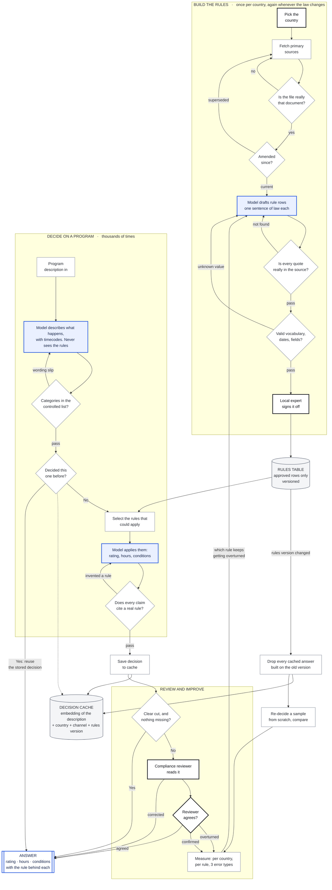

# Scaling to dozens of countries

## What this is

A plan for a system that answers one question: **given a description of a TV program, when
may it be shown in country X, and under what conditions?**

You do not need to have read Task 1 to read this. Briefly, that system works in two steps.
Step one reads a description of the program and writes down what happens in it, with
timecodes, in a fixed structure. Step two takes that list, looks up the rules for each
country, and produces a decision: a rating if the country issues one, the permitted hours,
any other conditions, and the reasoning with the rule behind each step. Step one never sees
the rules, which stops it shading its description toward an answer it expects.

It covers two countries and 105 rules, each carrying a word-for-word quote from the official
document behind it. This document is about what changes when you want thirty.

## The claim this rests on

**Most of the work is per country, not per program.** Collecting a country's rules, reading
them, having a lawyer confirm them: that happens once, and again when the law changes. After
that, deciding on a program is cheap.

So the cost curve is: expensive to add a country, cheap to add a program. Thirty countries is
thirty times the setup, not thirty times the running cost. That is the whole reason this is
worth building rather than hiring thirty reviewers.

Two things break that claim, and both are addressed below: laws change constantly once you
have thirty of them, and you cannot read most of the sources yourself.

---

## Process

Colors say **who or what does each step**, which matters more than the order. Every blue box
costs money per program and can be argued with. Every white box is free and cannot.

| | |
|---|---|
| 🟦 Model | Needs reading or weighing |
| ⬜ Code | Same input, same output. Costs nothing, cannot be argued with |
| ⬛ Person | A judgment with consequences |




---

## 1. Collecting and validating sources

**Primary sources only.** The law itself, the regulator's own binding rules, and their
decided cases. A regulator's summary page is a gloss, not the law. One French summary page
in Task 1 stated a stricter rule than the binding text; the row built from it was wrong.

**Every rule carries a word-for-word quote from the stored document, and a check compares
the two automatically.** If a quote stops matching its source, the build fails. This is the
single most valuable control in the system: it caught four bad rules the day real sources
arrived, and it is the reason a reviewer can check a rule without reading any code.

### The amendment problem, which is what bites at scale

Laws get amended, and an amendment usually edits an existing sentence rather than announcing
itself. Reading the original text of a French rule rather than the consolidated version
produced a rule that **under-rated** content, because a 2014 amendment had quietly broadened
the category. That reached the Task 1 table and had to be caught by hand.

At thirty countries this stops being an occasional event and becomes a stream. So:

- Store the consolidated text, never the original as enacted, and record which instrument
  last amended it.
- Re-check each source on a schedule, by comparing a fingerprint of the file rather than
  reading it. Changed fingerprint means a human reads the diff.
- When an amendment lands, every rule drawn from that document goes back to unconfirmed. It
  does not stay approved because it was approved yesterday.
- Keep a sample of decisions that rule produced, re-decide them from scratch against the new
  text, and compare. If the answers move, the amendment mattered and you now know how.

### Contradictions, translation, and gaps

**Contradictions get stored, not resolved.** Two sources disagreeing is a finding. Record
both, rank them by authority, and route to a person. A system that quietly picks one has
thrown away the only signal that something is wrong.

**Translation is a known weakness and must be labelled as one.** The French rules in Task 1
are quoted from an official English translation which itself says only the French is
authentic. Every rule records which language its quote is in. At thirty countries, assume
machine translation for triage and a native-language lawyer for sign-off.

**A gap is reported as a gap.** If no rule covers something in the program, the system says
so and escalates. It does not treat silence as permission. This matters more than it sounds:
in Task 1, France has no rule about alcohol in programs while the UK does, so a naive system
would report nothing for France and it would read as approval.

---

## 2. Organizing the rules

One table, one row per rule, with a fixed set of columns. The important design choices:

**Three separate answers, not one.** A country can restrict a program by giving it a rating,
by limiting the hours, or by requiring something else such as a PIN lock or an on-screen
symbol. These are independent, they can replace each other, and they can also stack. The
system reports all three separately and never derives one from another.

Why it matters: one rule says a film may be shown **at any hour** provided a PIN lock is in
place. Report "any time" without the condition and you have given a dangerous answer. Report
"barred until 9pm" without mentioning the lock and you have cost the broadcaster a slot it
was entitled to use.

**Store the machine-readable form beside the human one.** A column holding
`not_before=22:00` is what code can act on. The sentence beside it is what a lawyer reads.
Both, or the table is either unusable or uncheckable.

**Validity dates on every rule**, so a decision made last year can still be explained with
the rules that applied then. Rules are never deleted, only closed off with an end date.

**Three distinctions that must not collapse into one:**

| | |
|---|---|
| **How a rule applies** | Mechanically, or only once you confirm a condition, or by weighing a judgment |
| **Whether a person must sign it off** | A separate question with a separate answer |
| **How confident the extraction was** | A property of the reading, not of the rule |

Collapsing the first two was the single worst bug in Task 1. The system escalated **every
decision it ever made** because it escalated on the first column instead of the second, and
rules that describe *how to weigh things* appear in every decision while deciding nothing
themselves.

**Controlled vocabularies, enforced by the build.** Service types, content categories and
rule shapes come from fixed lists. A typo that invents a new value does not error, it
silently drops a rule out of every future decision. In Task 1 two spellings of one service
type dropped eight French rules, and nothing went red.

---

## Deliverable: how a single rule is represented

One rule, from the law to a decision.

**Collect.** The Arcom recommendation, consolidated text. Authority rank 2. Check what
amended it: a 2014 instrument broadened this category, so the original text would under-rate.

**Extract.**

```
rule_id           FR-SCH-002
country           FR
authority_rank    2
service_type      free_to_air; other_than_cinema_channels
content_category  scheduling_general
classification    III_-12
time_rule_machine not_before=22:00
determinacy       bright_line
human_review      no
verbatim_quote    "Pour les autres services de television, ces programmes ne
                   doivent pas etre diffuses avant 22 heures."
quote_lang        FR
source_doc        FR-R1c, art. 3
valid_from        2014-04-09
status            approved
```

The related rules stay as their own rows rather than being folded in here: a different row
carries the earlier hour for cinema channels, and another carries the exception that allows
20:30 on a limited number of occasions per year. One row, one sentence of law.

**Check.** The quote must appear character for character in the stored file. Two French rows
failed this and turned out to be paraphrased from a government summary rather than the
instrument.

**Sign off.** A French media lawyer confirms the reading and that the 2014 broadening is
captured.

**Use.** A program with sustained violence on a general channel at 20:45 → barred, because
this rule sets 22:00 and the service matches. The decision cites the rule id, so anyone can
check it.

**Monitor.** If reviewers keep overturning decisions resting on this rule, the threshold is
wrong and the rule goes back for re-reading.

---

## 3. Solution structure

Three levels, and the third is the one first drafts miss.

**Country** — the rules. Collected once, re-checked when the law changes.

**Program** — the description, extracted once and reused for every country. This is the part
that must not be repeated thirty times.

**Channel** — the level that is easy to forget. The same program on the same day can be legal
on one channel and not another, because rules attach to the kind of service: a premium film
channel with a PIN lock is not a free-to-air channel. In France, each channel also signs its
own contract with the regulator, **which can be stricter than the general law**.

So the lookup is: describe the program once, then for each country-and-channel pair, select
the rules that could apply and decide.

### Knowing whose rules apply at all

This is a real gap and it is worth half a page because the system quietly assumes an answer.

The system takes a country as input and applies that country's rules. That is only correct if
the country you hand it is the one whose regulator actually covers the channel. A channel can
be run from one country and watched in several, and countries disagree about who gets to
regulate it. Inside the EU, the rules of the country where the **company** is based apply,
and receiving countries must accept that. The UK, since leaving the EU, mainly goes by
whether the service is available in the UK.

**It is already live at two countries, not thirty.** A French-regulated channel showing a
program in the UK follows French rules.

It starts in the input itself. Descriptions arrive with a line naming countries, and nothing
defines what that line means: where it will be shown, where it was made, or where the rights
sit. The system reads it as "apply these countries' rules", which is the country-of-
destination answer and exactly the one France does not use. So the system **chooses** a
jurisdiction rather than being told one, silently.

**The fix, for version 2.** Two tables. One per channel: which regulator covers it, on what
basis, confirmed by whom and when. One per pair of countries: whether country B accepts
country A's regulator. The second belongs to the *relationship between two countries*, so it
is one shared grid rather than work repeated per channel. Then: find the channel's regulator,
check the receiving country accepts it, apply **exactly one** country's rules. If either
table has no confirmed answer, refuse to decide.

**One warning.** When two countries' rules differ, the instinct is to apply the stricter. That
is usually wrong, because usually only one country's rules were ever going to apply. Taking
the stricter one pushes content later than the law requires, and nobody ever complains about
that mistake, which is why it goes uncorrected.

In Europe there is a free public database, MAVISE, run by the European Audiovisual
Observatory, listing which country regulates each channel across 42 countries, updated
monthly from the regulators' own records. That is most of the first table. There is no
worldwide equivalent, so outside Europe this is lawyer work from the start.

### One country failing must not take down the rest

Each country is decided independently and a failure is reported per country. If France cannot
be decided because a source is unavailable, the UK answer still returns, with France marked
unavailable rather than the whole request failing.

---

## 4. Testing correctness

### Who decides the right answer, and why it cannot be us

The hardest part of this is not building the tests, it is knowing what the correct answer is.
A test set written by the same people who wrote the rules tests only self-consistency.

Three sources of truth, in order of strength:

1. **Decided enforcement cases.** The regulator has already ruled; the right answer is a
   matter of record. These are the only cases with no author bias at all. Task 1 has exactly
   one, which is its biggest weakness.
2. **A local lawyer's written determination**, obtained before the system is run on the case.
   Obtained afterwards it is a review of the output, which is a weaker thing.
3. **The broadcaster's own compliance decisions**, where they exist and were not disputed.

### Building the set

Per country, aim for a small set that covers: each content area that has rules, each kind of
channel, each rule that admits an exception, and at least **two benign cases that must come
back clear**.

That last one is not optional and it is the most commonly skipped. A test set made only of
difficult content can measure whether a system restricts enough. It cannot notice a system
that restricts **everything**, because nothing in it is supposed to come back clear. Task 1
ran for weeks with a test set of exactly that shape, and every decision it made escalated to
a human. The failure was invisible until a cookery program with a plaster on a cut finger was
added.

Run the cases blind: agents or reviewers who have not seen the expected answers. An author
running their own tests cannot find certain defects, because they already know what the
output should say.

---

## 5. Measuring and diagnosing

### The three ways of being wrong are not equally bad

| | What it means | Cost |
|---|---|---|
| **Under-restricting** | Cleared something the rule restricts | A regulatory breach. The one that ends careers |
| **Over-restricting** | Restricted something the rule allows | Lost airtime and revenue. Invisible, because nobody complains |
| **Escalating needlessly** | Sent a clear case to a person | The system saves no work and gets routed around |

Track all three separately. A single accuracy number hides the first inside the second,
and the second is the one that silently makes the tool useless.

### Telling a content mistake from a rules mistake

When an answer is wrong, the cause is in one of two places: step one described the program
wrongly, or step two applied the rules wrongly. These need completely different fixes, and a
single error rate cannot tell them apart.

Because the two steps are separate, you can test them separately. Give step two a description
you know is correct, written by hand. If the answer is still wrong, the fault is in the rules
or the prompt. If it is right, the fault was in the description.

### What else to track

- **Escalation rate per country.** A country escalating far more than its neighbours usually
  means its rules are badly extracted, not that its law is stricter.
- **Reviewer overturn rate per rule.** A rule whose decisions keep getting overturned has a
  miscalibrated threshold. This is the single best signal for which rule to re-read.
- **Coverage.** What fraction of content areas that have rules are actually exercised by the
  test set. A pass rate on a third of the table is not a pass rate.
- **Time since each source was last confirmed.** Age is the best available proxy for the risk
  that a rule is now wrong.

---

## What can be automated, and what needs a local expert

| Step | Who |
|---|---|
| Fetching sources, detecting that a document changed | **Automated** |
| Checking a quote still matches its source | **Automated** |
| Enforcing vocabularies, dates, internal consistency | **Automated** |
| Selecting which rules could apply to a program | **Automated** |
| Drafting rule rows from a legal document | Model, then a person |
| Describing what happens in a program | Model, then a person for anything borderline |
| Applying mechanical rules | **Automated** |
| **Deciding what a threshold means** | **Local expert** |
| **Confirming a translation is faithful** | **Local expert** |
| **Signing off a rule before it can decide anything** | **Local expert** |
| **Resolving a contradiction between two sources** | **Local expert** |
| **Confirming which regulator covers a channel** | **Local expert** |
| Final sign-off on anything the system escalated | Compliance reviewer |

The honest summary: **everything mechanical can be automated, and every threshold needs a
person.** Of Task 1's 105 rules, 45 turn on a judgment and only one decided case exists to
calibrate them. Collecting more decided cases is the highest-value work available, because it
is the only thing that turns a judgment into something measurable.

Finding the experts is the real constraint. Thirty countries means thirty jurisdictions'
qualified reviewers, and they are not interchangeable. This is a hiring and contracting
problem before it is a technical one, and it should be started before the engineering.

---

## Rollout order

1. **Two countries, deep.** Get the controls right: quote checking, amendment detection,
   blind testing, the three error types. These are cheaper to build at two countries and
   impossible to retrofit at thirty.
2. **Five countries, same legal family.** Western European, all under the same EU framework.
   This tests whether the rule structure survives contact with a country you did not design
   it around, without also testing translation and a different legal tradition at once.
3. **Add the jurisdiction tables**, before going outside the EU, because country-of-origin is
   where a confidently wrong answer comes from.
4. **Then widen.** Each new country is setup cost, and by now you know what that cost is.

## What I would tell whoever builds this

The thing that will go wrong is not the model. It is a rule that is quietly wrong, or quietly
missing, producing confident answers nobody questions.

So the controls that matter are the boring ones: every rule traceable to a quote that is
checked automatically, every vocabulary enforced by the build, a test set containing cases
that must come back **clear**, and the three error types tracked apart. Each of those caught a
real defect in Task 1 that reading would never have found.

And measure the escalation rate from day one. A system that sends everything to a person is
not being careful. It is not working.
